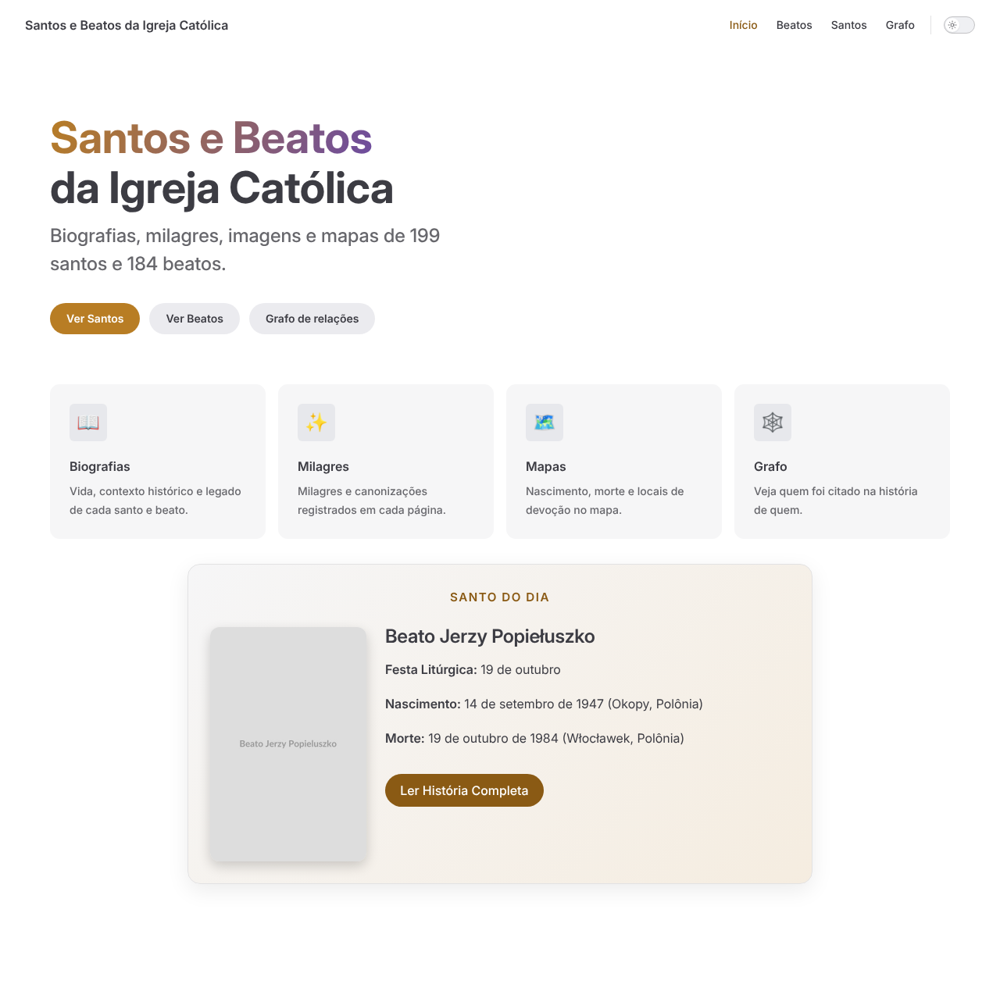

# Santos e Beatos

**Portal de biografias, milagres e mapas de 419 santos e beatos da Igreja Católica — para ler, ouvir e explorar.**

Site: **[juninmd.github.io/santos-e-beatos](https://juninmd.github.io/santos-e-beatos/)**

<p align="center">
  
</p>

## O que é

Um acervo em português com **217 santos** e **202 beatos** — 419 verbetes, acompanhados de **551 imagens**. Cada página reúne biografia, datas, festa litúrgica, milagres ou martírio, curiosidades e um mapa dos lugares por onde a pessoa passou.

O site é estático, feito com [VitePress](https://vitepress.dev/), e publicado pelo workflow de GitHub Pages a cada push em `master`. O mesmo conteúdo pode ser lido localmente, sem banco de dados e sem backend.

## Como navegar

| Seção | O que tem |
|---|---|
| **Início** | Santo do dia, festas da semana e atalhos para o acervo |
| **Explorar** | Todos os verbetes, com filtros por tipo, tema e século, e favoritos salvos no navegador |
| **Santos** e **Beatos** | Listas A–Z completas, com o explorador embutido |
| **Calendário** | Festas mês a mês, com exportação para a agenda |
| **Mapa** | Nascimentos, mortes, milagres e relíquias em um mapa-múndi interativo |
| **Constelação** | Grafo das citações entre verbetes: cada linha liga quem é citado na biografia de quem |

A busca é local e a narração em voz alta fica disponível nas páginas dos verbetes. Não há login nem backend: os favoritos ficam no armazenamento local do navegador.

## O que há em cada verbete

O topo traz a imagem, uma citação e os campos **Nascimento**, **Morte**, **Canonização** ou **Beatificação** e **Festa Litúrgica**. Depois vêm as seções **Biografia**, **Milagres** (ou **Martírio**), **Curiosidades**, **Cidades por onde passou** e **Impacto Hoje**.

O mapa de cada página é montado com o componente `MiracleMap` e marcadores de nascimento, vida, morte e devoção.

## Estrutura

```text
docs/
├── index.md, explorar.md, calendario.md, mapa.md, grafo.md
├── santos/<slug>/index.md          # 217 verbetes
├── santos/<slug>/imagens/          # retratos e obras
├── beatos/<slug>/index.md          # 202 verbetes
├── beatos/<slug>/imagens/
├── .vitepress/config.js            # navegação, busca local e sidebar
├── .vitepress/components/          # explorador, calendário, mapa, grafo, narração
├── saints.data.js                  # carrega e normaliza os verbetes
├── relations.data.js               # citações cruzadas para o grafo
└── mapa.data.js                    # pinos de todos os MiracleMap
scripts/
├── verificar-conteudo.mjs          # valida a estrutura de todas as páginas
├── gerar-indices.mjs               # regenera sidebar e listas A–Z
└── gerar-retratos.mjs              # gera cartões SVG para páginas sem imagem
```

Cada entrada é um diretório com `index.md` e uma pasta `imagens/`. Não há CMS: o conteúdo é o próprio Markdown.

## Rodando localmente

Pré-requisito: Node.js 20, a versão fixada em `.nvmrc`.

```bash
npm ci
npm run docs:dev      # servidor de desenvolvimento do VitePress
npm run docs:build    # build estático em docs/.vitepress/dist
npm run docs:preview  # serve o build local
npm test              # valida o conteúdo
```

`npm test` roda `scripts/verificar-conteudo.mjs`, que falha se uma página não tiver frontmatter com `title` e `description`, H1, citação, `<TextToSpeech />`, imagem local existente, os campos de datas, a seção de milagres ou martírio e um `<MiracleMap>` com pinos válidos. É uma verificação de estrutura, não uma suíte de testes unitários.

## Como contribuir e corrigir

1. Crie `docs/santos/<slug>/index.md` ou `docs/beatos/<slug>/index.md` seguindo uma página existente.
2. Coloque a imagem em `imagens/` dentro da pasta do verbete. O validador recusa imagem externa.
3. Preencha os campos e as seções obrigatórias e inclua o `<MiracleMap>` com as coordenadas.
4. Rode `npm test` e depois `npm run docs:dev` para conferir a renderização.
5. Para correções de datas, nomes ou referências, abra uma issue ou um pull request com a fonte.

Os scripts auxiliares completam o trabalho:

```bash
npm run conteudo:verificar   # o mesmo validador do npm test
npm run conteudo:indices     # regenera sidebar e as listas A–Z
npm run conteudo:retratos    # gera cartões SVG para quem não tem imagem
```

> [!WARNING]
> `conteudo:indices` atualiza a sidebar e as listas A–Z, mas no fim tenta reescrever o `README.md` a partir do cabeçalho `## Lista de Santos e Beatos` e recria a tabela antiga com todos os verbetes. Esta versão do README não tem mais esse cabeçalho, então o script termina com erro depois de atualizar a navegação — o README fica intacto. Rode-o apenas quando precisar regenerar sidebar e listas, ou ajuste o script para não tocar no README.

## Índice completo

A lista A–Z não é duplicada neste arquivo. O índice canônico fica no próprio site:

- [Explorar o acervo](https://juninmd.github.io/santos-e-beatos/explorar) — filtros por tipo, tema e século.
- [Lista de santos](https://juninmd.github.io/santos-e-beatos/santos/) — 217 entradas.
- [Lista de beatos](https://juninmd.github.io/santos-e-beatos/beatos/) — 202 entradas.

## CI e publicação

| Workflow | O que faz |
|---|---|
| `pages.yml` | `npm ci`, `npm test`, build e deploy no GitHub Pages (push em `master`) |
| `validate.yml` | Validação de pull requests e pushes |
| `security.yml` | Varredura de segredos com gitleaks |
| `sast.yml` | Análise estática com Semgrep, em modo informativo |
| `dependabot-auto-merge.yml` | Merge automático de PRs do Dependabot quando os checks passam |

Há também um `netlify.toml` com o mesmo build, como alternativa de hospedagem.

## Licença

[CC0-1.0](LICENSE).
