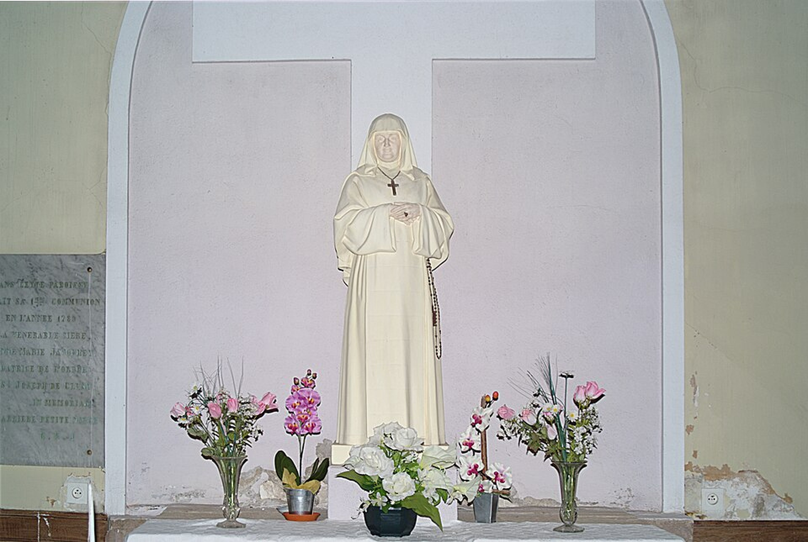
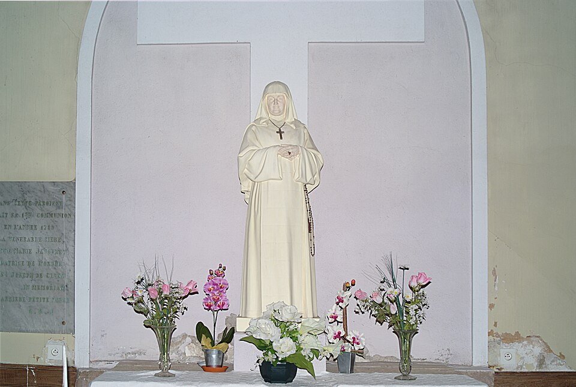

# Beata Ana Maria Javouhey

> "Fazer o bem aos outros é a melhor maneira de amar a Deus."

- **Nascimento:** 10 de novembro de 1779, Jallanges, Borgonha, França
- **Morte:** 15 de julho de 1851, Paris, França
- **Beatificação:** 15 de outubro de 1950, pelo Papa Pio XII
- **Festa Litúrgica:** 15 de julho

<TextToSpeech />

---

## Biografia

Ana Maria Javouhey nasceu durante o período turbulento que precedeu a Revolução Francesa. Cresceu em um ambiente onde a religião era frequentemente perseguida. Ainda jovem, durante a Revolução, arriscou sua vida escondendo padres refratários (que não haviam jurado fidelidade ao governo revolucionário) e ajudando na celebração de missas clandestinas.

Sentindo um forte chamado à vida religiosa, tentou ingressar em várias congregações, mas não encontrou seu lugar. Inspirada por um sonho onde Santa Teresa de Ávila lhe mostrava crianças de várias raças pedindo ajuda, ela fundou a Congregação das Irmãs de São José de Cluny em 1807. O objetivo da congregação era educar crianças, cuidar de órfãos e ajudar os necessitados, independentemente de raça ou origem.

O trabalho das Irmãs de São José de Cluny se expandiu rapidamente. A pedido do governo francês, Madre Javouhey enviou irmãs para as colônias francesas, incluindo o Senegal, a Guiana Francesa e a Reunião. Na Guiana Francesa, ela realizou um projeto audacioso em Mana: criou uma colônia autossustentável onde escravos libertos e prisioneiros pudessem viver e trabalhar com dignidade, aprendendo ofícios e recebendo educação e formação religiosa, mostrando na prática que era possível emancipar os escravos e integrá-los na sociedade.

## Vida Pessoal e Espiritualidade

Mulher de grande força de vontade e fé inabalável, Ana Maria frequentemente enfrentou forte oposição tanto do clero quanto de autoridades governamentais que não concordavam com sua visão pioneira de educação universal e emancipação dos escravos. Sua espiritualidade baseava-se em fazer sempre e em todos os lugares a "Santa Vontade de Deus".

## Milagres

Inúmeros milagres foram atribuídos à sua intercessão após sua morte, principalmente curas inexplicáveis. Durante sua vida, ela sobreviveu a várias epidemias (como a febre amarela) que dizimaram muitos ao seu redor nas missões, o que muitos consideraram uma proteção providencial para que ela continuasse sua obra.

## Curiosidades

1.  **Libertação:** Muito antes da abolição da escravatura na França, ela emancipou os escravos na colônia de Mana, na Guiana Francesa.
2.  **Oposição:** Devido ao seu estilo de liderança forte, chegou a ser privada dos sacramentos por um bispo na França durante dois anos, mas manteve-se obediente e humilde, acabando por ser reintegrada.
3.  **Expansão Global:** Foi chamada de "o grande homem de estado" por líderes políticos de sua época devido à sua capacidade de organização.

## Galeria de Imagens e Restaurações

| Original | Restaurada em 4K |
| :---: | :---: |
|  |  |

## Cidades por onde passou

<MiracleMap :items='[
  { lat: 46.9489, lng: 5.1786, type: "nascimento", title: "Jallanges, França", description: "Local de nascimento e onde ajudou padres durante a Revolução Francesa." },
  { lat: 5.6601, lng: -53.7766, type: "vida", title: "Mana, Guiana Francesa", description: "Onde fundou a colônia modelo para a emancipação de escravos libertos." },
  { lat: 48.8566, lng: 2.3522, type: "morte", title: "Paris, França", description: "Local de seu falecimento em 1851." }
]' />

## Impacto Hoje

Hoje, as Irmãs de São José de Cluny estão presentes em todos os continentes, dedicando-se à educação, saúde, trabalho social e missões em mais de 50 países. A Beata Ana Maria Javouhey é lembrada como uma pioneira da libertação, dos direitos humanos e do amor sem fronteiras.
