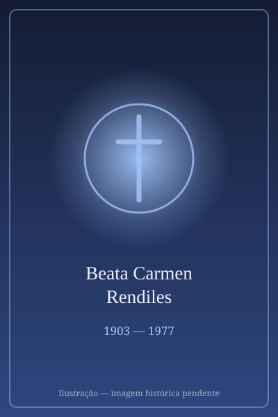

# Beata Carmen Rendiles

> "Deus nos criou sem nos perguntar, mas não nos salvará sem a nossa cooperação."

- **Nascimento:** 11 de agosto de 1903, Caracas, Venezuela
- **Morte:** 9 de maio de 1977, Caracas, Venezuela
- **Beatificação:** 16 de junho de 2018 pelo Papa Francisco (cerimônia presidida pelo Cardeal Angelo Amato)
- **Festa Litúrgica:** 9 de maio

<TextToSpeech />

---

## Biografia

Carmen Elena Rendiles Martínez nasceu em Caracas, Venezuela, em 1903, a terceira de nove irmãos de uma família rica e influente. Nasceu sem o braço esquerdo, uma condição que, na época, poderia ter sido vista como uma grande limitação, mas que nunca a impediu de viver uma vida plena e ativa. Foi educada com base em fortes valores católicos e, desde cedo, demonstrou uma profunda inclinação para a vida religiosa.

Em 1927, ingressou na congregação francesa das Servas de Jesus no Santíssimo Sacramento, em Caracas. Destacou-se pela sua inteligência, liderança e profunda devoção eucarística. Foi enviada para a França para completar sua formação, retornando à Venezuela posteriormente. Em 1965, sentindo que a congregação original havia perdido seu carisma inicial após o Concílio Vaticano II, Madre Carmen liderou um grupo de irmãs venezuelanas e colombianas para fundar uma nova congregação: as Servas de Jesus, dedicadas ao cuidado de padres diocesanos pobres, a educação religiosa e ao serviço em seminários e missões. Ela governou a nova congregação como Madre Geral até a sua morte em 1977.

## Vida Pessoal e Espiritualidade

Madre Carmen era conhecida por sua personalidade forte, mas ao mesmo tempo materna e acolhedora. Sua deficiência física nunca foi usada como desculpa; ao contrário, ela mesma realizava trabalhos pesados e lidava com a administração dos conventos com grande eficiência. Sua espiritualidade era profundamente centrada na Eucaristia e no amor à Igreja. Ela frequentemente encorajava as suas irmãs a buscar a santidade nas pequenas coisas e no trabalho árduo e silencioso do dia a dia.

## Milagres

O milagre que levou à sua beatificação envolveu a cura milagrosa de Trinette Durán de Branger, uma cirurgiã venezuelana. Em 2003, Trinette sofreu uma grave descarga elétrica no braço direito, perdendo completamente a sensibilidade e os movimentos do braço, paralisando sua carreira e causando fortes dores por meses, sem que os tratamentos médicos surtissem efeito. Após rezar pedindo a intercessão da Madre Carmen Rendiles num convento, a médica sentiu um calor intenso no braço e recuperou subitamente toda a mobilidade e sensibilidade, podendo voltar a operar. A cura foi declarada instantânea, completa e duradoura pelo Vaticano.

## Curiosidades

1. **Deficiência de nascença:** Carmen nasceu sem o braço esquerdo devido a uma malformação congênita, mas isso nunca a impediu de pintar, bordar ou tocar piano. Ela usava uma prótese.
2. **Fundadora e líder:** Ela é a fundadora da primeira congregação religiosa de origem totalmente venezuelana, as Servas de Jesus.
3. **Terceira beata venezuelana:** Ela se tornou a terceira beata da história da Venezuela, seguindo Maria de San José e Candelaria de San José.
4. **Devoção aos padres:** Uma das missões centrais da congregação que ela fundou era garantir que sacerdotes diocesanos idosos ou necessitados tivessem assistência material e espiritual.

## Cidades por onde passou

Sua vida foi principalmente centrada na Venezuela (Caracas), com períodos de formação na França e missões de expansão de sua congregação na Colômbia.

<MiracleMap :items='[
  { lat: 10.4806, lng: -66.9036, type: "nascimento", title: "Caracas, Venezuela", description: "Local de nascimento e onde fundou as Servas de Jesus." },
  { lat: 43.6045, lng: 1.444, type: "vida", title: "Toulouse, França", description: "Onde realizou parte de sua formação religiosa." },
  { lat: 10.4916, lng: -66.9026, type: "morte", title: "Colégio Belén, Caracas, Venezuela", description: "Local de seu falecimento em 9 de maio de 1977." },
  { lat: 10.4900, lng: -66.9000, type: "milagre", title: "Caracas, Venezuela", description: "Onde ocorreu a cura milagrosa da cirurgiã Trinette Durán." }
]' />

## Impacto Hoje

A Beata Carmen Rendiles é um símbolo poderoso de resiliência e fé. Seu exemplo inspira muitas pessoas, especialmente aquelas que vivem com deficiências físicas, mostrando que limitações aparentes não impedem realizações extraordinárias a serviço de Deus e do próximo. A Congregação das Servas de Jesus que ela fundou continua ativa hoje, mantendo colégios, cuidando de paróquias e assistindo padres em vários países da América Latina, perpetuando o seu legado de serviço e amor à Eucaristia.
