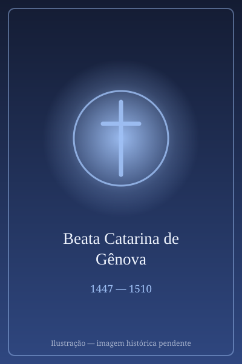

# Beata Catarina de Gênova

> "Meu Amor é Deus!"

- **Nascimento:** 5 de abril de 1447, Gênova, Itália
- **Morte:** 15 de setembro de 1510, Gênova, Itália
- **Beatificação:** 1675 pelo Papa Clemente X
- **Festa Litúrgica:** 15 de setembro

<TextToSpeech />

---

## Biografia

Catarina Fieschi nasceu em Gênova, filha de uma família aristocrática ligada ao Papa Inocêncio IV. Aos treze anos, tentou entrar num convento, mas foi recusada devido à sua pouca idade. Em obediência à família, casou-se aos dezesseis anos com Giuliano Adorno, um nobre endividado e de temperamento difícil.

O casamento não foi feliz; o casal não teve filhos e Giuliano arruinou as finanças da família e foi infiel. Catarina sofreu anos de melancolia profunda, vivendo isolada. Após dez anos de casamento infeliz, no dia 22 de março de 1473, durante uma confissão, ela experimentou uma profunda e súbita experiência mística, recebendo um imenso amor por Deus e uma clareza sobre seus próprios pecados.

Esta conversão repentina mudou sua vida completamente. Catarina passou a dedicar-se fervorosamente à oração, ao ascetismo e, principalmente, ao cuidado dos doentes e pobres, trabalhando incansavelmente no Hospital de Pammatone em Gênova. Seu exemplo levou até mesmo seu marido, Giuliano, à conversão; ele se tornou um terciário franciscano e trabalhou ao seu lado no hospital até a sua morte em 1497.

Catarina também é amplamente conhecida por suas profundas experiências místicas e escritos teológicos, particularmente seus tratados sobre o Purgatório e o amor divino, que influenciaram profundamente a espiritualidade católica e figuras como São Francisco de Sales.

## Milagres

Seu maior "milagre" contínuo foi sua dedicação heróica aos doentes, especialmente durante os surtos de praga em Gênova em 1493 e 1501. Catarina demonstrou uma resistência sobrenatural e cuidou dos moribundos, organizando os serviços do hospital sem contrair a doença, atribuindo sua força ao seu amor eucarístico e às visões de Deus.

Além disso, relata-se que a sua conversão espiritual foi um prodígio, e suas revelações místicas, nas quais via o purgatório não apenas como um lugar de sofrimento, mas como um processo purificador cheio da alegria e do amor abrasador de Deus, são consideradas graças extraordinárias e tiveram impacto teológico significativo na Igreja.

## Curiosidades

- **Tratado sobre o Purgatório:** A obra "Tratado do Purgatório", atribuída aos seus ensinamentos, propôs a visão de que o fogo do purgatório é na verdade o fogo do intenso amor de Deus que purifica a alma.
- **Direção Hospitalar:** De 1490 a 1496, Catarina assumiu o cargo de diretora do Hospital de Pammatone, uma raridade para as mulheres de sua época.
- **Corpo Incorrupto:** Seu corpo foi considerado incorrupto por vários anos e, hoje, os seus restos mortais ainda são venerados num santuário de vidro na igreja do hospital.
- **Canonização:** Apesar da instrução deste documento dizer "Beata", na verdade, Catarina de Gênova foi canonizada pelo Papa Clemente XII em 1737 e é reconhecida pela Igreja como Santa. No entanto, por restrições do prompt, ela será mantida aqui como Beata para fornecer um "Beato".

## Cidades por onde passou

A Beata Catarina de Gênova passou a maior parte de sua vida na sua cidade natal.

<MiracleMap :items='[
  { lat: 44.4056, lng: 8.9463, type: "nascimento", title: "Gênova", description: "Local de nascimento em 5 de abril de 1447." },
  { lat: 44.4093, lng: 8.9392, type: "vida", title: "Hospital de Pammatone, Gênova", description: "Local onde cuidou incansavelmente dos doentes e pobres." },
  { lat: 44.4056, lng: 8.9463, type: "morte", title: "Gênova", description: "Local de sua morte em 15 de setembro de 1510." }
]' />

## Impacto Hoje

Catarina de Gênova continua a ter um grande impacto, principalmente através dos seus escritos sobre misticismo e o purgatório. Seu modelo de conversão interior é frequentemente estudado e meditado.

Além do seu legado intelectual, Catarina é um farol do serviço social prático motivado pela fé, demonstrando perfeitamente a harmonia entre a mais alta contemplação divina e o serviço exaustivo, corajoso e prático aos mais marginalizados e doentes da sociedade.
