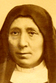

# Beata Elena Guerra

> "Apóstola do Espírito Santo"

- **Nascimento:** 23 de junho de 1835, Lucca, Itália
- **Morte:** 11 de abril de 1914, Lucca, Itália
- **Beatificação:** 26 de abril de 1959, pelo Papa João XXIII
- **Festa Litúrgica:** 11 de abril

<TextToSpeech />

---

## Biografia

Elena Guerra nasceu na cidade de Lucca, na Itália, no dia 23 de junho de 1835, em uma família cristã fervorosa. Foi uma mulher de saúde muito frágil durante a juventude; mesmo assim, demonstrou profundo amor e dedicação aos estudos de religião, literatura e música.

Ao longo de sua vida, Elena sentiu a necessidade urgente de espalhar a devoção ao Espírito Santo pela Igreja e pelo mundo, argumentando que as graças transformadoras e a união mística com a Terceira Pessoa da Santíssima Trindade eram vitais para os fiéis.

## Vida Pessoal e Espiritualidade

Como resultado de seu zelo incansável, Elena enviou cartas influentes ao Papa Leão XIII, encorajando-o a promover publicamente a devoção ao Espírito Santo. Suas palavras e fervor inspiraram o Papa Leão XIII a publicar a encíclica "Divinum illud munus" (1897), abordando precisamente a doutrina e devoção ao Divino Espírito.

Em Lucca, fundou a Congregação das Irmãs Oblatas do Espírito Santo (também conhecidas como as Irmãs de Santa Zita), cujo foco era não apenas a educação de meninas, mas também cultivar as almas na chama viva e perene do Espírito. Entre as meninas de sua congregação que alcançaram a santidade destaca-se a santa canonizada Gemma Galgani.

## Milagres

Elena Guerra passou os últimos anos de sua vida entre mal-entendidos e incompreensões, enfrentando humilhações dentro da própria congregação que fundou, sendo destituída de seu cargo de liderança. Sofreu as provações com um espírito humilde e em constante submissão à vontade divina, confiante na renovação do seu Instituto.

Em 1959, graças aos milagres que lhe foram atribuídos, ela foi beatificada por João XXIII, que a chamou de "Apóstola moderna do Espírito Santo". Em 2024, o Papa Francisco aprovou mais um milagre atribuído a sua intercessão, pavimentando o caminho para sua futura canonização. O milagre abriu um novo capítulo para os devotos que ansiavam sua consagração definitiva.

## Curiosidades

1.  **Doutrina e Epistolário:** Ela ficou famosa pelos inúmeros pequenos livros devocionais que escreveu, além de suas intensas epístolas dirigidas ao Vaticano pedindo a renovação espiritual da Igreja no novo século, antecipando o movimento carismático católico.
2.  **Relação com Santa Gemma Galgani:** Sua congregação dedicava-se intensamente à instrução da juventude feminina, e entre as ex-alunas mais ilustres de seu colégio figura Santa Gemma Galgani, a mística de Lucca.
3.  **Veneração:** Seu corpo descansa na igreja de Santo Agostinho, em Lucca, Itália.

## Cidades por onde passou

<MiracleMap :items='[
  { lat: 43.8427, lng: 10.5027, type: "nascimento", title: "Lucca, Itália", description: "Sua cidade natal, onde fundou a Congregação e onde viveu, pregou e morreu." },
  { lat: 41.9028, lng: 12.4533, type: "morte", title: "Lucca, Itália", description: "Onde o impacto de suas cartas alcançou o Papa Leão XIII, impulsionando a devoção ao Espírito Santo." }
]' />

## Impacto Hoje

Hoje, a beata Elena Guerra é celebrada pelas comunidades de renovação carismática em todo o mundo. Seus escritos pioneiros incentivam ainda os fiéis a terem o Espírito Santo como guia contínuo de suas vidas cristãs. Suas palavras continuam moldando de maneira vibrante o papel do laicato no trabalho constante da evangelização da Igreja.
