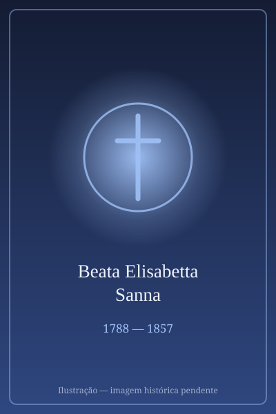

# Beata Elisabetta Sanna

> "Deus me chamou para sofrer, e eu aceito a Sua vontade com amor e paciência."

- **Nascimento:** 23 de abril de 1788, Codrongianos, Sardenha, Itália
- **Morte:** 17 de fevereiro de 1857, Roma, Itália
- **Beatificação:** 17 de setembro de 2016, pelo Papa Francisco (representado pelo Cardeal Angelo Amato)
- **Festa Litúrgica:** 17 de fevereiro

<TextToSpeech />

---

## Biografia

Elisabetta Sanna nasceu em 23 de abril de 1788, em Codrongianos, uma pequena cidade na Sardenha, Itália. Proveniente de uma família de agricultores, ela viveu uma infância simples e marcada pela fé cristã, mas também pelo sofrimento precoce: aos três meses de idade, contraiu varíola, o que a deixou com uma deficiência nos braços, impedindo-a de erguê-los.

Em 1807, casou-se com Antonio Porcu, com quem teve sete filhos. A vida do casal foi marcada pelo amor mútuo e pela dedicação à família e aos necessitados. Eles frequentemente abrigavam pobres e viajantes em sua casa. Em 1825, seu marido faleceu, deixando Elisabetta viúva aos 37 anos, com cinco filhos vivos para criar sozinha (dois haviam falecido prematuramente).

Em 1831, sentindo um forte chamado espiritual, Elisabetta partiu para uma peregrinação à Terra Santa, confiando seus filhos aos cuidados de parentes. No entanto, sua viagem foi interrompida em Roma devido a problemas de saúde e dificuldades financeiras. Lá, ela conheceu São Vicente Pallotti, que se tornou seu diretor espiritual. Sob a orientação dele, Elisabetta percebeu que sua verdadeira missão não era na Terra Santa, mas em Roma, onde se dedicou intensamente à oração, à caridade e ao serviço aos doentes e pobres, além de ser uma das primeiras colaboradoras da União do Apostolado Católico, fundada por Pallotti.

## Milagres

A beatificação de Elisabetta Sanna foi aprovada após o reconhecimento de um milagre atribuído à sua intercessão:

**A cura de uma jovem brasileira (2008):** Uma jovem em São Paulo, Brasil, sofria de uma grave infecção que a levou a um estado de coma, com prognóstico médico de morte iminente. Sua família e amigos, ao conhecerem a história de Elisabetta Sanna através dos padres Palotinos locais, iniciaram uma novena pedindo sua intercessão. A jovem despertou do coma de forma repentina e inexplicável, recuperando-se totalmente sem sequelas, o que foi considerado medicamente inexplicável.

## Curiosidades

1. **Deficiência Superada:** Apesar de sua deficiência física nos braços devido à varíola, ela realizava suas tarefas domésticas e cuidava de sua família com grande habilidade e amor.
2. **Mãe Espiritual:** Em Roma, seu apartamento tornou-se um refúgio para muitas pessoas que buscavam consolo e orientação espiritual, incluindo cardeais, nobres e pessoas simples. Ela era frequentemente chamada de "A Santa de Roma".
3. **Colaboradora de São Vicente Pallotti:** Ela foi fundamental na fundação e expansão da União do Apostolado Católico, dedicando sua vida a apoiar o trabalho missionário e caritativo da organização.

## Cidades por onde passou

<MiracleMap :items='[
  { lat: 40.6625, lng: 8.6811, type: "nascimento", title: "Codrongianos, Itália", description: "Cidade natal, onde nasceu, casou-se e formou sua família." },
  { lat: 41.9028, lng: 12.4964, type: "morte", title: "Roma, Itália", description: "Onde viveu os últimos 26 anos de sua vida, colaborando com São Vicente Pallotti e dedicando-se à caridade." }
]' />

## Impacto Hoje

A Beata Elisabetta Sanna é lembrada como um modelo extraordinário de esposa, mãe, viúva e apóstola leiga. Seu impacto hoje ressoa especialmente entre as mulheres e mães que enfrentam desafios e sofrimentos. Ela ensina que a santidade não requer feitos grandiosos aos olhos do mundo, mas sim uma profunda confiança em Deus, paciência nas provações e um amor ativo e compassivo pelo próximo. Sua vida inspira leigos a assumirem seu papel ativo na missão da Igreja, independentemente de suas limitações físicas ou circunstâncias da vida.
