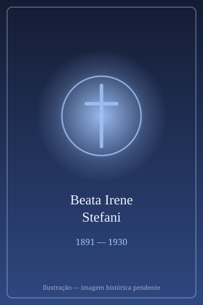

# Beata Irene Stefani

> "Jesus, só Jesus! Tudo por Ele, com Ele e n'Ele."

- **Nascimento:** 22 de agosto de 1891, Anfo, Bréscia, Itália
- **Morte:** 31 de outubro de 1930, Gikondi, Quénia
- **Beatificação:** 23 de maio de 2015, pelo Papa Francisco (cerimônia no Quénia)
- **Festa Litúrgica:** 31 de outubro

<TextToSpeech />

## Biografia

Aurelia Jacoba Mercede Stefani nasceu no norte de Itália, numa família profundamente cristã. Desde cedo demonstrou uma inclinação para a vida religiosa e para a caridade. Após a morte prematura da sua mãe, ela ajudou a cuidar dos seus irmãos, mas o chamamento para as missões era demasiado forte.

Em 1911, entrou no Instituto das Irmãs Missionárias da Consolata, fundado pelo Beato José Allamano, adotando o nome de Irmã Irene. O seu maior desejo era partir para as missões em África, o que se concretizou no final de 1914, quando foi enviada para o Quénia.

Durante a Primeira Guerra Mundial, Irene trabalhou como enfermeira nos hospitais militares no Quénia e na Tanzânia, assistindo aos feridos e aos carregadores (conhecidos como *carriers*), muitos dos quais morriam de doenças e exaustão. A sua dedicação incansável e amor profundo valeram-lhe a alcunha carinhosa de "Nyaatha" (Mãe de Misericórdia) por parte do povo Kikuyu.

## Milagres

Para a sua beatificação, foi reconhecido um milagre ocorrido em Moçambique, em 1989. Durante a guerra civil, na missão de Nipepe, na província do Niassa, mais de 270 pessoas refugiaram-se na igreja paroquial, cercada por combatentes. Sem acesso a água, as pessoas temiam morrer de sede e desidratação sob o calor intenso.

O pároco, auxiliado pelas freiras e pelos catequistas, invocou a intercessão da Irmã Irene Stefani. Uma pequena pia batismal, que continha apenas poucos litros de água, foi milagrosamente multiplicada. A água nunca se esgotou e foi suficiente para saciar a sede e permitir que as 270 pessoas cozinhassem, limpassem as crianças e sobrevivessem durante os quatro dias em que estiveram isoladas, antes de serem libertadas.

## Curiosidades

1. **As Suas Botas:** Irene era conhecida pelas suas pesadas botas militares. Ela caminhava dezenas de quilómetros pelos trilhos do Quénia para visitar os doentes, ensinar o catecismo e ajudar as mulheres e crianças em necessidade.
2. **"Nyaatha":** O povo local a venerava tanto que, na língua Kikuyu, "Nyaatha" significa aquela que é cheia de misericórdia e amor.
3. **Morte Prematura:** Morreu aos 39 anos de idade, vítima de peste bubónica, doença que contraiu ao cuidar de um paciente infectado, dando literalmente a sua vida pelos doentes.

## Impacto Hoje

A Beata Irene Stefani é um grande modelo de caridade cristã, inculturação e sacrifício missionário na África moderna. A sua beatificação em Nyeri, no Quénia, reuniu milhares de fiéis, atestando a devoção perene do povo queniano. Ela continua a inspirar o trabalho humanitário e de enfermagem nas periferias do mundo, ensinando que o amor verdadeiro exige doação total.

## Cidades por onde passou

<MiracleMap :items='[
  { lat: 45.7667, lng: 10.4667, type: "nascimento", title: "Anfo, Itália", description: "Local de nascimento e infância." },
  { lat: 45.0703, lng: 7.6869, type: "vida", title: "Turim, Itália", description: "Onde se formou como Irmã Missionária da Consolata." },
  { lat: -0.4167, lng: 36.9500, type: "vida", title: "Nyeri, Quénia", description: "Centro das suas atividades missionárias e hospitalares." },
  { lat: -13.2333, lng: 37.3833, type: "milagre", title: "Nipepe, Moçambique", description: "Local do milagre da multiplicação da água durante a guerra civil." },
  { lat: -0.5280, lng: 37.0392, type: "morte", title: "Gikondi, Quénia", description: "Onde adoeceu, faleceu de peste bubónica e foi primeiramente enterrada." }
]' />
