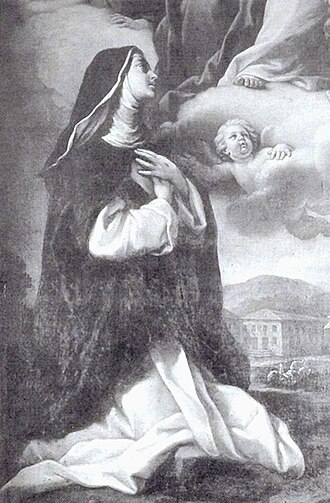

# Beata Lúcia de Narni

> "Consoladora dos aflitos."

- **Nascimento:** 13 de dezembro de 1476, Narni, Itália
- **Morte:** 15 de novembro de 1544, Ferrara, Itália
- **Beatificação:** 1 de março de 1710, pelo Papa Clemente XI
- **Festa Litúrgica:** 15 de novembro

<TextToSpeech />

---

## Biografia

Lúcia de Narni (Lucia Brocadelli) foi uma mística católica e terciária dominicana italiana. Pertencente a uma família nobre, desde cedo sentiu forte chamado à vida religiosa, fazendo um voto secreto de virgindade. Aos 15 anos, sua família a obrigou a casar-se com o Conde Pietro di Milan, mas ela conseguiu persuadi-lo a viverem como irmãos, num casamento casto (casamento espiritual).

Três anos depois, Lúcia deixou a vida conjugal (com o consentimento do marido, que mais tarde ingressou na Ordem Franciscana) e tornou-se terciária dominicana. Foi enviada para Viterbo, onde reuniu um grupo de mulheres para viver em comunidade e onde começou a experimentar intensas visões místicas e a receber os estigmas.

O Duque de Ferrara, Hércules I d'Este, impressionado com sua fama de santidade, pediu ao Papa que a transferisse para Ferrara, onde fundou o Mosteiro de Santa Catarina de Siena, do qual se tornou priora.

## Milagres

A vida de Lúcia foi repleta de fenômenos sobrenaturais. Os estigmas que portava foram rigorosamente examinados e atestados por teólogos, bispos e até pelo duque de Ferrara. Após sua morte, o seu túmulo tornou-se um local de peregrinação, onde fiéis relatavam frequentes curas físicas inexplicáveis e graças espirituais, resultando em sua beatificação em 1710.

## Curiosidades

1. **Os Estigmas:** Lúcia recebeu os estigmas em 25 de fevereiro de 1496. As feridas eram profundas e lhe causavam sofrimento intenso, que ela oferecia pela salvação das almas.
2. **Vida de Penumbra:** Após a morte do Duque Hércules I, seu principal protetor, as freiras que vieram de outros conventos começaram a tratá-la com severidade e, injustamente, a destituíram do cargo de priora, confinando-a numa cela por quase 40 anos, período que ela aceitou com heroica paciência.

## Cidades por onde passou

<MiracleMap :items='[
  { lat: 42.518, lng: 12.515, type: "nascimento", title: "Narni, Itália", description: "Local de nascimento e infância." },
  { lat: 42.418, lng: 12.106, type: "vida", title: "Viterbo, Itália", description: "Onde recebeu os estigmas e viveu como dominicana." },
  { lat: 44.838, lng: 11.619, type: "morte", title: "Ferrara, Itália", description: "Local de falecimento e onde viveu enclausurada." }
]' />

## Impacto Hoje

A Beata Lúcia de Narni continua a ser um poderoso exemplo de obediência, humildade e sofrimento oferecido em silêncio. A sua aceitação heroica de décadas de marginalização dentro do seu próprio convento é uma lição de fé inabalável. Suas relíquias descansam na Catedral de Narni, inspirando os cristãos modernos a perseverarem, mesmo diante da incompreensão de seus pares.
