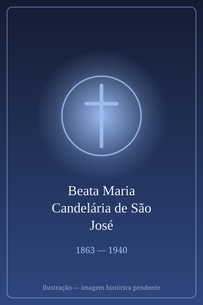

# Beata Maria Candelária de São José

> "Consoladora dos Abandonados"

- **Nascimento:** 11 de agosto de 1863, Altagracia de Orituco (Venezuela)
- **Morte:** 31 de janeiro de 1940, Cumaná (Venezuela)
- **Beatificação:** 27 de abril de 2008, pelo Papa Bento XVI
- **Festa Litúrgica:** 1 de fevereiro

<TextToSpeech />

---

## Biografia

Nascida Susana Paz-Castillo Ramírez, em Altagracia de Orituco, a Beata Maria Candelária de São José cresceu numa época de forte turbulência política e social na Venezuela. A sua infância e juventude foram marcadas pelo amor aos doentes e à caridade cristã, uma vocação instigada pelos pais. Após a morte do pai, assumiu com coragem a assistência aos mais necessitados da sua terra, especialmente num hospital local fundado pelo Padre Sixto Sosa.

Movida por um chamamento profundo a servir a Deus, assumiu o nome religioso de Maria Candelária de São José e fundou a Congregação das Irmãs Carmelitas de Madre Candelária, focada em assistir e aliviar os doentes, os idosos e os marginalizados. A sua obra destacou-se num contexto de pobreza extrema e falta de condições sanitárias, atuando com grande heroísmo durante epidemias e períodos de convulsão.

Ela governou a congregação durante várias décadas como Superiora Geral, destacando-se pela paciência perante as doenças e as cruzes, vivendo numa contínua e simples obediência ao espírito da Ordem do Carmo.

## Milagres

O milagre que lhe abriu o caminho para a beatificação ocorreu em 1995, na Venezuela. A cura rápida, completa e inexplicável para a medicina de uma mulher, Rafaela Meza de Zambra, que sofria de um grave problema cardíaco e risco imediato de morte, aconteceu após intensas preces dirigidas à Madre Maria Candelária de São José.

## Curiosidades

1. **Ação nas Epidemias:** Madre Candelária dedicou boa parte da sua vida ao cuidado destemido de doentes de varíola e de outras epidemias que assolaram a Venezuela na viragem do século XX.
2. **Humildade e Paz:** Embora tenha sido a fundadora da congregação, a sua humildade e vida simples levavam a que por vezes não se distinguisse das demais irmãs perante visitantes, insistindo sempre em realizar as tarefas mais humildes e pesadas.
3. **Pioneira na Venezuela:** Tornou-se na segunda mulher venezuelana a ser elevada à glória dos altares na história da Igreja.

## Cidades por onde passou

A ação de Maria Candelária ocorreu fundamentalmente no seu país natal.

<MiracleMap :items='[
  { lat: 9.8653, lng: -66.3811, type: "nascimento", title: "Altagracia de Orituco (Venezuela)", description: "Local de nascimento e onde deu início à sua obra hospitalar." },
  { lat: 10.4578, lng: -64.1755, type: "morte", title: "Cumaná (Venezuela)", description: "Onde entregou serenamente a sua alma a Deus, aos 76 anos." }
]' />

## Impacto Hoje

A obra de Madre Candelária, refletida no Instituto das Irmãs Carmelitas, permanece vibrante em muitas frentes da América Latina. O seu testemunho continua a inspirar o cuidado terno para com os mais vulneráveis. A dedicação da Beata aos idosos, órfãos e doentes relembra as sociedades contemporâneas sobre o dever da compaixão e da presença amorosa nos contextos de exclusão. A sua beatificação reafirmou a importância espiritual e humanitária das ordens religiosas no auxílio às populações desfavorecidas.
