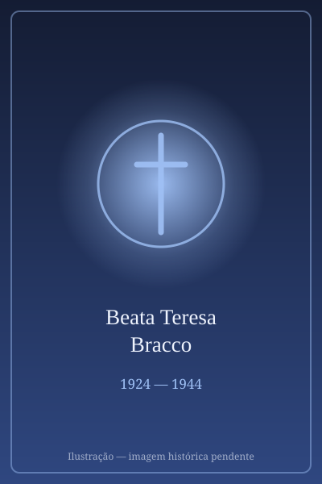

# Beata Teresa Bracco

> "Prefiro morrer a pecar."

- **Nascimento:** 24 de fevereiro de 1924, Santa Giulia (Itália)
- **Morte:** 28 de agosto de 1944, Santa Giulia (Itália)
- **Beatificação:** 24 de maio de 1998, pelo Papa João Paulo II
- **Festa Litúrgica:** 28 de agosto

<TextToSpeech />

---

## Biografia

Teresa Bracco nasceu em Santa Giulia, uma pequena aldeia da província de Savona, no norte de Itália. Cresceu no seio de uma família de agricultores, caracterizada por uma profunda fé e piedade. Desde muito jovem, revelou um espírito inclinado para a oração, a Eucaristia diária e um grande amor a Nossa Senhora, cultivando o desejo de se consagrar a Deus.

A sua vida decorreu na simplicidade do trabalho no campo e na dedicação à sua paróquia. Teresa era conhecida pela sua modéstia, pureza e alegria, sendo um exemplo para as outras jovens da sua aldeia. Frequentemente rezava o rosário enquanto trabalhava, demonstrando uma forte espiritualidade ancorada nas realidades do dia a dia.

A Segunda Guerra Mundial trouxe sofrimento e instabilidade à sua região, com o aumento da presença de tropas nazis e confrontos constantes.

## Martírio

O milagre de Teresa Bracco reside no seu martírio pela pureza. A 28 de agosto de 1944, a sua aldeia foi atacada e saqueada por tropas nazis. Durante a invasão, um soldado alemão apanhou Teresa, separou-a do grupo de aldeões que fugiam para os bosques e tentou abusar dela.

Teresa resistiu heroicamente com todas as suas forças para defender a sua castidade, recusando-se a ceder às exigências do agressor, recordando os ensinamentos da sua fé sobre o valor da pureza. Enfurecido pela sua forte resistência, o soldado estrangulou-a e depois alvejou-a fatalmente, martirizando-a.

A Igreja reconheceu a sua morte como um verdadeiro martírio "in defensum castitatis" (em defesa da castidade), semelhante ao de Santa Maria Goretti, demonstrando a coragem de sacrificar a própria vida para preservar a graça e a união com Deus.

## Curiosidades

1.  **Devoção Mariana:** Teresa era profundamente devota de Nossa Senhora. O seu diário espiritual revela uma constante invocação a Maria para a ajudar a viver uma vida santa e pura.
2.  **Influência:** A sua história espalhou-se rapidamente após a sua morte, inspirando muitos jovens na Itália pós-guerra a valorizar a castidade e a fé num período de grande reconstrução moral e material.
3.  **Vida Comum:** O seu percurso demonstra que a santidade não requer ações extraordinárias, mas uma vivência heróica das virtudes comuns na vida diária de trabalho e oração.

## Cidades por onde passou

Toda a vida terrena de Teresa decorreu nos arredores da sua aldeia natal.

<MiracleMap :items='[
  { lat: 44.4833, lng: 8.3167, type: "nascimento", title: "Santa Giulia, Savona, Itália", description: "Local de nascimento e de toda a sua vida (24 de fevereiro de 1924)." },
  { lat: 44.4833, lng: 8.3167, type: "morte", title: "Santa Giulia, Savona, Itália", description: "Local do seu martírio em defesa da castidade (28 de agosto de 1944)." }
]' />

## Impacto Hoje

A Beata Teresa Bracco é venerada como um poderoso testemunho do valor da dignidade humana, do respeito pelo corpo e do heroísmo feminino. Num mundo onde, por vezes, estes valores são ameaçados, a sua figura permanece atual como modelo de fortaleza e fé para os jovens. A sua beatificação por João Paulo II destacou a importância de viver o amor autêntico que prefere sacrificar tudo, até a vida, do que cometer pecado e ofender a Deus.
