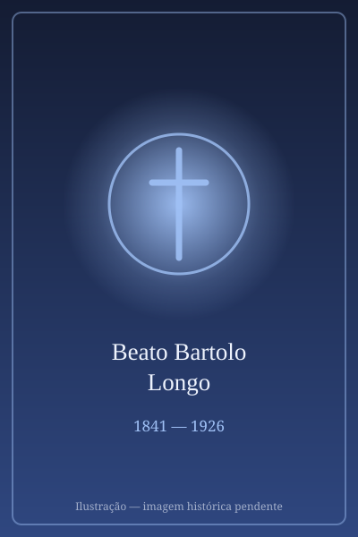

# Beato Bartolo Longo

> "O apóstolo do Rosário que se converteu do ocultismo satânico para propagar a devoção à Virgem de Pompeia."

- **Nascimento:** 10 de fevereiro de 1841 (Latiano, Itália)
- **Morte:** 5 de outubro de 1926 (Pompeia, Itália)
- **Beatificação:** 26 de outubro de 1980
- **Festa Litúrgica:** 5 de outubro

---

<TextToSpeech />

## Biografia

Bartolo Longo nasceu em 1841 numa família burguesa católica da Itália. Durante a juventude, foi estudar Direito na Universidade de Nápoles num período conturbado, marcado por um forte anticlericalismo, ideias racionalistas e nacionalismo italiano de Garibaldi. Distanciando-se de sua fé, Longo caiu no mundo do ocultismo e do espiritismo, tão populares na época. Chegou até mesmo a ser ordenado "sacerdote" satânico e a participar ativamente de rituais contra a Igreja.

Sua imersão no satanismo o levou a uma profunda depressão, confusão mental e pensamentos suicidas. Pela graça de Deus, ele foi resgatado e aconselhado por um professor amigo seu e por um padre dominicano, o Padre Radente. Longo abandonou o ocultismo, confessou-se e retornou com fervor à fé católica, tornando-se membro da Ordem Terceira de São Domingos, com o nome de "Irmão Rosário".

No entanto, o remorso e o sentimento de indignidade o perseguiam. Um dia, andando pelo vale desolado e empobrecido de Pompeia, que era administrado por uma nobre amiga, Mariana de Fusco (com quem ele mais tarde se casaria sob voto de castidade por motivos de propriedade e proteção caritativa), ele sentiu o desespero voltar, questionando se sua alma estava salva após ter servido a Satanás. Foi então que ele teve uma locução interior recordando a promessa da Virgem a São Domingos: *“Quem propaga o Rosário se salva!”*. Nesse momento, caiu de joelhos e prometeu não sair do vale de Pompeia até que tivesse divulgado a oração.

Ele restaurou a pequena e arruinada igreja paroquial local e começou a convidar os camponeses a rezar o Rosário, usando o hoje famoso quadro de "Nossa Senhora do Rosário de Pompeia". Rapidamente, milagres começaram a ocorrer. As doações choveram de toda parte, o que lhe permitiu construir um imponente santuário e várias obras de caridade imensas ao redor, como orfanatos, escolas e casas para os filhos dos prisioneiros. Bartolo Longo dedicou o resto de sua vida, sua energia e sua fortuna inteira à Virgem de Pompeia.

## Milagres

* **Cura de Clorinda Lucarelli:** Clorinda sofria de fortes crises epilépticas e obteve cura súbita ao orar diante do quadro de Nossa Senhora em Pompeia.
* **Cura do sobrinho do Papa:** A cura milagrosa de um jovem moribundo relacionado à nobreza romana chocou o público, o que aumentou a fama do Santuário e atraiu multidões.
* Ao longo dos anos, as inumeráveis graças atribuídas a Nossa Senhora de Pompeia através da devoção promovida por Bartolo incluem incontáveis curas e conversões repentinas, transformando a região antes desolada num centro mundial de fé.
* O milagre reconhecido para a sua beatificação envolveu a cura de uma mulher com um tumor maligno incurável e disseminado, que rezou invocando o Beato Bartolo e ficou perfeitamente curada.

## Curiosidades

* Era advogado de profissão, o que lhe deu habilidades excepcionais para administrar legal e financeiramente a construção da enorme cidade nova de Pompeia e de suas instituições sociais.
* João Paulo II o chamou de “O Homem da Virgem Maria” e o citou amplamente em sua carta apostólica *Rosarium Virginis Mariae*, quando o Papa proclamou os Mistérios Luminosos do Rosário.
* Ele é um padroeiro moderno excepcional para as pessoas ex-dependentes, deprimidas e aquelas que sofreram com o envolvimento no ocultismo e espiritismo, demonstrando que ninguém está longe demais da Misericórdia Divina.

## Cidades por onde passou

* Latiano, Itália: Sua cidade natal, no sul da Itália.
* Nápoles, Itália: Onde estudou, abandonou a fé e entrou para o ocultismo, e onde posteriormente experimentou a sua conversão através do encontro com intelectuais católicos.
* Pompeia, Itália: A região árida em ruínas onde prometeu propagar o Rosário. Ele literalmente fundou a "Nova Pompeia" a partir da caridade.

## Impacto Hoje

Hoje, o Santuário de Nossa Senhora do Rosário de Pompeia atrai milhões de peregrinos anualmente. A obra social de Bartolo Longo continua abrigando crianças, órfãos e jovens desfavorecidos. Ele é uma figura de profunda esperança para o século XXI, uma lembrança viva de que até mesmo quem desce às profundezas da oposição a Deus (o satanismo e o ocultismo) pode, pela oração do Rosário, alcançar os cumes mais altos da santidade e mudar a vida de milhares.

<MiracleMap :items='[
  { lat: 40.5562, lng: 17.7121, title: "Nascimento", description: "Latiano, Itália, local de seu nascimento.", type: "nascimento" },
  { lat: 40.7501, lng: 14.5005, title: "Falecimento e Santuário de Pompeia", description: "O grandioso Santuário fundado por Bartolo Longo, onde ele faleceu e hoje se encontram as suas relíquias.", type: "morte" }
]' />