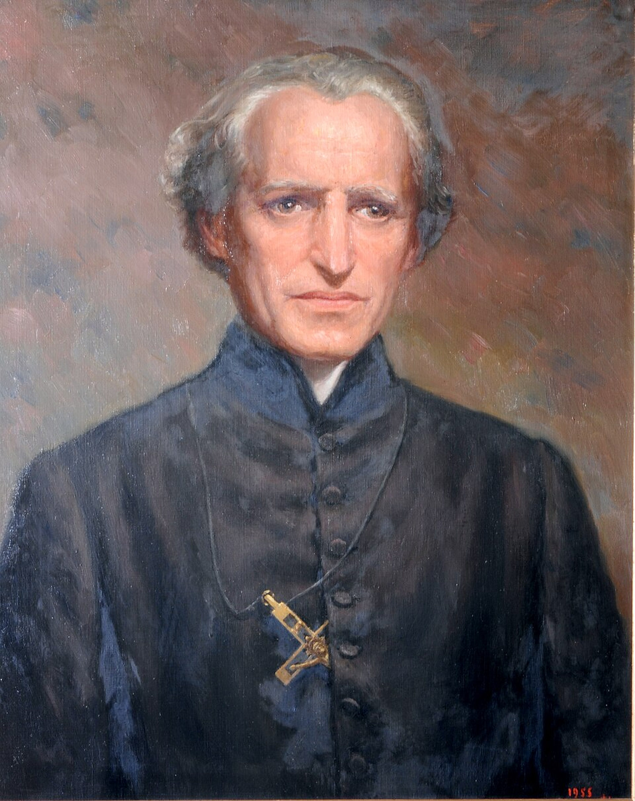
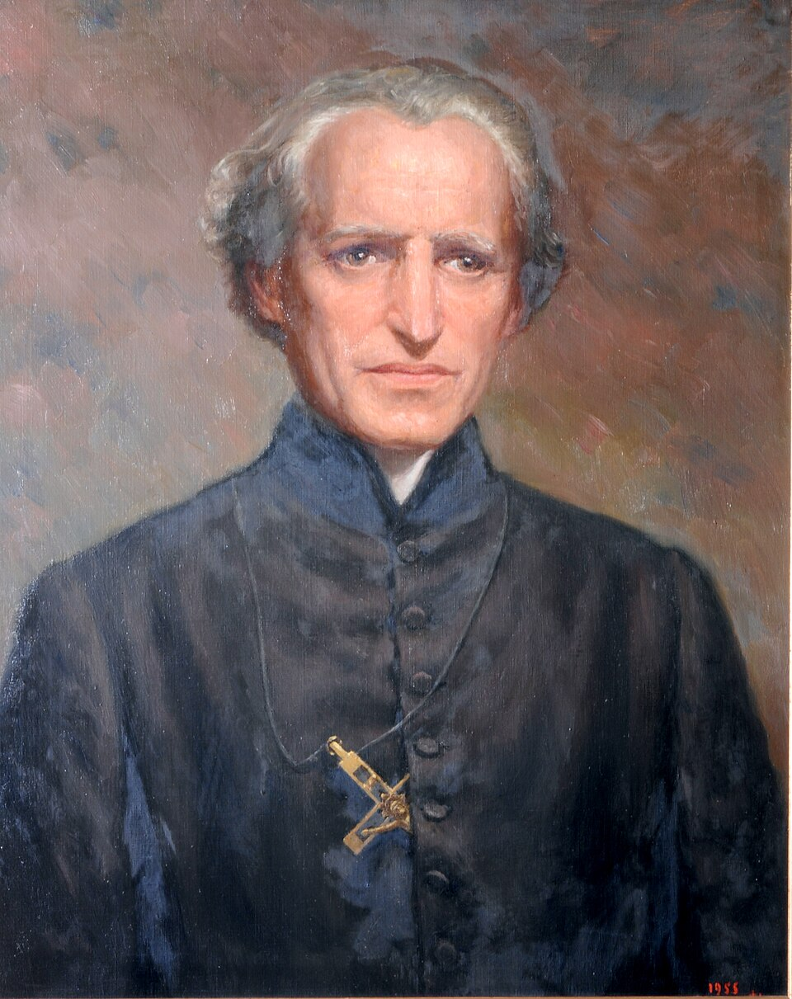

# Beato Basílio Moreau

> "A cruz é a nossa única esperança."

- **Nascimento:** 11 de fevereiro de 1799 (Laigné-en-Belin, França)
- **Morte:** 20 de janeiro de 1873 (Le Mans, França)
- **Beatificação:** 15 de setembro de 2007
- **Festa Litúrgica:** 20 de janeiro

<TextToSpeech />

---

## Biografia

Basile-Antoine Marie Moreau (Basílio Antônio Maria Moreau) nasceu perto do fim da Revolução Francesa em Laigné-en-Belin, um pequeno vilarejo perto de Le Mans, na França. Em uma época marcada por agitação política e social e perseguições à Igreja Católica, Moreau foi criado por pais piedosos. O impacto devastador da Revolução sobre a Igreja na França moldaria profundamente sua missão de vida: reconstruir a sociedade através da educação e da restauração da fé.

Ele estudou no seminário de Le Mans e foi ordenado sacerdote diocesano em 1821, pouco antes de completar 23 anos, graças a uma dispensa especial. Em 1835, reuniu um grupo de padres auxiliares (Padres Auxiliares de Le Mans) para ajudar os párocos da diocese nas áreas rurais devastadas. Paralelamente, organizou um grupo de irmãos (Irmãos de São José) para atuar como educadores rurais.

Com o tempo, Moreau consolidou a união desses dois grupos (padres e irmãos) e, posteriormente, adicionou um grupo de freiras (Marianitas de Santa Cruz). Em 1837, formalizou a Congregação de Santa Cruz (Congregatio a Sancta Cruce - C.S.C.), dedicada à educação e ao trabalho pastoral. A congregação enviou missionários não apenas por toda a França, mas também para os Estados Unidos, Canadá, Argélia, Índia e outros lugares. O trabalho de Moreau focou em cultivar tanto a mente quanto o coração, defendendo que a educação verdadeira deve integrar a formação acadêmica e espiritual.

Os últimos anos de Moreau foram marcados por tribulações e perdas. A congregação enfrentou grandes dificuldades financeiras e divisões internas, e Moreau chegou a renunciar ao cargo de superior geral. Ele morreu no dia 20 de janeiro de 1873, marginalizado por muitos da comunidade que havia fundado, mas sem perder a esperança na Providência Divina e no mistério da cruz.

## Milagres

- **A Cura de Marceline L'Étoile:** O milagre que abriu caminho para sua beatificação envolveu a cura inexplicável de Marceline L'Étoile, uma jovem canadense sofrendo de uma grave doença pleural e tuberculose em 1948. A comunidade das Irmãs de Santa Cruz, acompanhada de familiares da jovem, rezou pedindo a intercessão do Padre Moreau. De forma rápida, completa e duradoura, e contra as previsões médicas, ela recuperou totalmente a saúde.

## Curiosidades

- **A Família de Santa Cruz:** A congregação que Moreau fundou foi organizada intencionalmente segundo o modelo da Sagrada Família: os padres eram consagrados ao Sagrado Coração de Jesus, os irmãos ao Coração Puro de São José, e as irmãs ao Imaculado Coração de Maria.
- **A Universidade de Notre Dame:** A semente plantada por Moreau cruzou o Atlântico quando enviou o Padre Edward Sorin (junto com irmãos da congregação) aos Estados Unidos, onde fundaram a renomada Universidade de Notre Dame, em Indiana, hoje uma das instituições católicas de ensino superior mais respeitadas do mundo.
- **Fé na Adversidade:** Moreau enfrentou profundas crises financeiras e deserções na sua congregação. A sua frase "A cruz é a nossa única esperança" (Spes Unica) não era apenas um lema espiritual, mas a vivência prática e dolorosa das suas últimas décadas, confiando em Deus através do sofrimento.

## Cidades por onde passou
- **Laigné-en-Belin:** Cidade natal onde cresceu na França pós-revolucionária.
- **Le Mans:** Cidade central de seu ministério, onde foi ordenado e fundou a Congregação de Santa Cruz.
- **Sainte-Croix:** O bairro em Le Mans, e depois a sede da nova comunidade da qual a Congregação tirou o nome.

<MiracleMap :items='[
  { lat: 47.8864, lng: 0.2294, type: "nascimento", title: "Laigné-en-Belin", description: "Local de nascimento em 1799." },
  { lat: 48.0061, lng: 0.1996, type: "vida", title: "Le Mans", description: "Sede de seu sacerdócio e fundação da Congregação de Santa Cruz." },
  { lat: 48.0016, lng: 0.2078, type: "morte", title: "Le Mans", description: "Local de sua morte em 1873." }
]' />

## Impacto Hoje

O impacto do Beato Basílio Moreau continua vivo principalmente na Congregação de Santa Cruz, que opera uma vasta rede de escolas de ensino fundamental e médio, faculdades, universidades e missões pastorais em diversos continentes. Instituições como a Universidade de Notre Dame, a Universidade de Portland, a St. Edward's University e o King's College são testemunhos do seu modelo pedagógico centrado em preparar cidadãos para o mundo e para a vida eterna. Sua visão de que a "mente não deve ser cultivada à custa do coração" é um pilar da educação católica contemporânea na família de Santa Cruz.

## Galeria de Imagens e Restaurações

| Original | Restaurada em 4K |
| :---: | :---: |
|  |  |

### Outras Imagens

| Imagem | Descrição |
| --- | --- |
|  | Retrato do Beato Basílio Moreau. |
