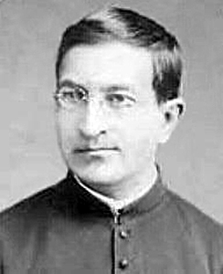

# Beato Bronislaw Markiewicz

> "Desejo reunir milhões de jovens abandonados e alimentar seus corpos e almas."

- **Nascimento:** 13 de julho de 1842, Pruchnik, Polônia
- **Morte:** 29 de janeiro de 1912, Miejsce Piastowe, Polônia
- **Beatificação:** 24 de junho de 2005, pelo Papa Bento XVI
- **Festa Litúrgica:** 30 de janeiro

<TextToSpeech />

---

## Biografia

Bronisław Markiewicz nasceu em 13 de julho de 1842, em Pruchnik, na atual Polônia, sendo o sexto de onze filhos em uma família profundamente cristã. Durante a juventude, no ensino médio, chegou a perder a fé por causa do ambiente antirreligioso da época, mas recuperou-a após uma profunda crise existencial, sentindo o chamado de Deus. Entrou no seminário em Przemyśl e foi ordenado sacerdote em 1867.

Foi um pároco extremamente dedicado aos mais necessitados, frequentemente doando suas próprias roupas aos pobres. Desejoso de aprofundar sua vida religiosa, viajou para a Itália, onde conheceu São João Bosco em 1885. A forte espiritualidade de Dom Bosco o levou a ingressar na Sociedade Salesiana em 1887, fazendo seus votos nas mãos do próprio fundador.

Ao retornar à Polônia em 1892, Bronisław assumiu uma paróquia em Miejsce Piastowe. Diante da pobreza extrema e da miséria das crianças e jovens abandonados, ele começou a organizar abrigos e escolas baseados no modelo salesiano. Posteriormente, por divergências sobre a radicalidade da pobreza, ele fundou suas próprias congregações, a Congregação de São Miguel Arcanjo (Padres Miguelitas) e a congregação feminina equivalente, aprovadas após sua morte. Faleceu em 29 de janeiro de 1912, desgastado por uma vida de extremo sacrifício e trabalho intenso.

## Vida Pessoal e Obra

O Beato Bronislaw era movido por um amor extraordinário aos mais vulneráveis. Ele viveu uma vida de pobreza radical para poder sustentar as crianças que acolhia. Em sua casa, os jovens não apenas recebiam comida e teto, mas também educação técnica e formação moral e religiosa. Ele acreditava que "trabalho e oração" eram os dois pilares fundamentais para transformar a juventude abandonada.

## Milagres

A cura inexplicável de um sacerdote na Polônia, que sofria de uma grave e irreversível doença nas vias urinárias e infecção generalizada, foi atribuída à intercessão do Padre Bronisław. Este milagre levou à sua beatificação, que aconteceu em 2005 em Varsóvia, sendo aprovada pelo Papa João Paulo II e promulgada sob a autoridade do Papa Bento XVI.

## Curiosidades

1. **Padres Miguelitas:** As congregações que ele fundou, inspiradas na devoção a São Miguel Arcanjo, continuam até hoje o trabalho com crianças órfãs e jovens em situação de risco em diversos países.
2. **Profecia:** O Padre Markiewicz é muito conhecido na Polônia por uma profecia escrita em 1892, na qual previu que um polonês se tornaria Papa (o que se cumpriu com São João Paulo II).
3. **Visita de João Bosco:** A influência de Dom Bosco sobre ele foi tão marcante que ele é frequentemente chamado de "Dom Bosco da Polônia".

## Impacto Hoje

Hoje, as Congregações de São Miguel Arcanjo continuam a missão do Beato Bronisław, focando na educação, catequese e apoio social a crianças em vários países. Seu exemplo de dedicação integral aos marginalizados e a coragem de viver a pobreza evangélica radical desafiam a sociedade moderna a olhar para os mais necessitados.

## Cidades por onde passou

<MiracleMap :items='[
  { lat: 49.9119, lng: 22.5256, type: "nascimento", title: "Pruchnik, Polônia", description: "Local de nascimento do Beato Bronisław Markiewicz." },
  { lat: 49.7828, lng: 22.7725, type: "vida", title: "Przemyśl, Polônia", description: "Onde estudou no seminário e foi ordenado sacerdote." },
  { lat: 45.0703, lng: 7.6869, type: "vida", title: "Turim, Itália", description: "Onde encontrou São João Bosco e entrou para a ordem dos Salesianos." },
  { lat: 49.6381, lng: 21.7825, type: "morte", title: "Miejsce Piastowe, Polônia", description: "Onde fundou a sua congregação e local de sua morte." }
]' />

## Galeria de Imagens e Restaurações

| Imagem Original |
| :---: |
|  |