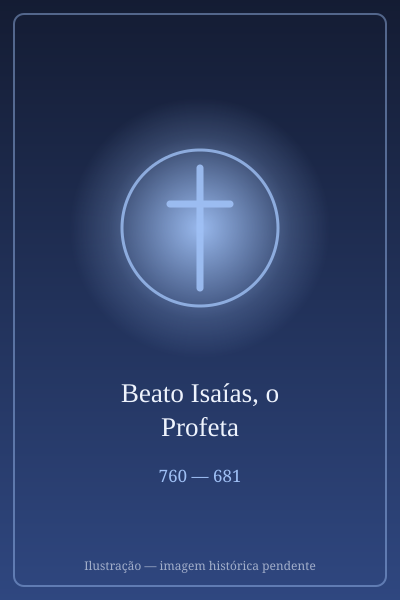

# Beato Isaías, o Profeta

> "Eis-me aqui, envia-me a mim"

- **Nascimento:** c. 760 a.C., Jerusalém (Reino de Judá)
- **Morte:** c. 681 a.C., Jerusalém
- **Beatificação:** Culto imemorial
- **Festa Litúrgica:** 9 de maio

<TextToSpeech />

## Biografia

Isaías, filho de Amoz, é considerado o maior dos profetas do Antigo Testamento. Nascido no Reino de Judá, provavelmente em Jerusalém, por volta de 760 a.C., sua vida e ministério estiveram profundamente ligados à corte real. Ele viveu durante os reinados de Uzias, Jotão, Acaz e Ezequias.

Sua vocação profética ocorreu por volta de 740 a.C., no ano da morte do rei Uzias, quando teve uma visão majestosa de Deus no Templo, relatada no capítulo 6 de seu livro. Nessa visão, sentindo-se indigno, um serafim purificou seus lábios com uma brasa ardente. Quando Deus perguntou: "A quem enviarei?", Isaías prontamente respondeu: "Eis-me aqui, envia-me a mim."

Isaías desempenhou um papel político e espiritual crucial, aconselhando reis durante tempos de grande crise, como a invasão siro-efraimita e o cerco assírio a Jerusalém. Ele pregava a confiança absoluta em Deus, condenava a injustiça social e a corrupção moral, e alertava sobre o julgamento iminente se o povo não se arrependesse. Segundo a tradição judaica (registrada no Talmud e em apócrifos como o "Martírio de Isaías"), ele foi martirizado durante o reinado do ímpio rei Manassés, sendo serrado ao meio.

## Milagres

No contexto profético, os "milagres" de Isaías estão ligados aos grandes sinais de Deus e às suas profecias precisas:

- **O Recuo da Sombra:** Durante o reinado de Ezequias, Isaías orou e Deus fez a sombra recuar dez graus no relógio de sol de Acaz, como sinal de que o rei seria curado (Isaías 38:8).
- **O Livramento de Jerusalém:** Isaías profetizou que Jerusalém não cairia nas mãos de Senaqueribe. Milagrosamente, o anjo do Senhor feriu 185.000 soldados assírios em uma única noite, salvando a cidade (Isaías 37).

## Curiosidades

1. **O "Quinto Evangelista":** Devido à riqueza e precisão de suas profecias sobre o Messias (incluindo o nascimento virginal e o Cântico do Servo Sofredor), São Jerônimo chamou Isaías de "o quinto evangelista".
2. **O Livro de Isaías:** Seu livro é um dos mais longos e complexos da Bíblia, e o "Rolo de Isaías", encontrado entre os Manuscritos do Mar Morto, é o manuscrito bíblico completo mais antigo já descoberto, datando de cerca de 125 a.C.
3. **Morte Brutal:** A tradição de sua morte por ter sido serrado ao meio é mencionada de forma velada no Novo Testamento, na Carta aos Hebreus (11:37).

## Cidades por onde passou

O ministério de Isaías esteve quase que exclusivamente centrado na capital do Reino do Sul:

- **Jerusalém:** Onde ele nasceu, teve sua visão no Templo, profetizou, aconselhou reis e, segundo a tradição, foi martirizado.

## Impacto Hoje

O impacto de Isaías é incalculável. Suas palavras moldaram a teologia messiânica do cristianismo, e o Novo Testamento cita seu livro mais do que qualquer outro profeta. Suas visões de paz universal — onde "transformarão suas espadas em arados" (Isaías 2:4) — continuam a inspirar movimentos pacifistas e organizações globais como a ONU. Na liturgia cristã, especialmente durante o Advento e a Semana Santa, os textos de Isaías são proclamados para celebrar a vinda, a paixão e a glória de Jesus Cristo.

<MiracleMap :items='[
  { lat: 31.7683, lng: 35.2137, type: "nascimento", title: "Jerusalém", description: "Local de nascimento, ministério e martírio do profeta." },
  { lat: 31.7766, lng: 35.2355, type: "vida", title: "Templo de Salomão (Jerusalém)", description: "Local da visão de seu chamado profético." },
  { lat: 31.768, lng: 35.213, type: "morte", title: "Jerusalém (Martírio)", description: "Local onde, segundo a tradição, foi serrado ao meio sob ordem de Manassés." }
]' />
