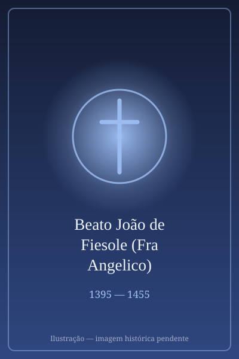

# Beato João de Fiesole (Fra Angelico)

> "Para pintar as coisas de Cristo, deve-se viver com Cristo."

- **Nascimento:** c. 1395, Vicchio di Mugello, Florença (Itália)
- **Morte:** 18 de fevereiro de 1455, Roma (Itália)
- **Beatificação:** 3 de outubro de 1982, pelo Papa João Paulo II
- **Festa Litúrgica:** 18 de fevereiro

<TextToSpeech />

---

## Biografia

Guido di Pietro, mais conhecido como Fra Angelico, foi um frade dominicano e um dos mais célebres pintores do início do Renascimento italiano. Nasceu em Vicchio di Mugello e ingressou na Ordem dos Pregadores (Dominicanos) em Fiesole entre 1418 e 1421.

A sua arte sempre foi concebida como uma extensão de sua oração e pregação. As suas pinturas, repletas de figuras angelicais, madonas luminosas e cenas da Paixão, procuravam inspirar devoção e contemplação naqueles que as observavam. Diz-se que ele nunca alterou um traço, considerando-o ditado pela vontade de Deus, e que muitas vezes pintava a crucificação com lágrimas nos olhos.

Os seus talentos valeram-lhe convites prestigiosos para adornar o Convento de São Marcos em Florença e, mais tarde, o Vaticano, trabalhando sob as ordens dos papas Eugénio IV e Nicolau V. Recusou cargos importantes, como o de Arcebispo de Florença, para poder continuar a pintar e permanecer na sua vida modesta de frade.

## Vida Pessoal e Espiritualidade

Fra Angelico combinava a vida ascética e contemplativa dos dominicanos com o seu trabalho de pintor. Nunca quis receber remuneração pessoal pelos seus quadros. A pureza de coração de Fra Angelico, e o estado de graça em que buscava manter-se durante o seu ofício, conferiam aos seus murais e altares aquela luminosidade serena que levou os seus contemporâneos a alcunharem-no de "Pictor Angelicus" (Pintor Angélico).

Ele viveu numa época de renovação estética e, mesmo abraçando as inovações em perspetiva e realismo anatómico do seu tempo, ele focou a arte num propósito estritamente espiritual.

## Milagres

Em relação a Fra Angelico, a santidade centrou-se no seu testemunho extraordinário e na influência pacífica da sua arte. A tradição popular atribui-lhe a preservação de doentes e a resolução de conflitos, mas a principal maravilha por ele realizada é, figurativamente, a sua arte transcendente.
Quando João Paulo II o beatificou em 1982 e, logo em 1984, o nomeou o Padroeiro dos Artistas e Pintores, sublinhou a forma como o mestre alcançara o estado contemplativo perfeito e comunicava a verdade teológica com o pincel, assemelhando o ato da pintura a uma bênção perene.

## Curiosidades

1. **Nome de nascimento e o nome religioso:** Nasceu como Guido di Pietro, tomou o nome de Fra Giovanni da Fiesole (Irmão João de Fiesole) ao entrar para a ordem, e é universalmente aclamado como Fra Angelico.
2. **O Choro e a Arte:** Há registos de que não começava um quadro antes de rezar intensamente e que, sempre que pintava a imagem de Cristo Crucificado, derramava lágrimas copiosas.
3. **Tumulo Histórico:** O seu corpo descansa na Igreja de Santa Maria sopra Minerva, em Roma, onde o seu epitáfio foi encomendado por um papa.

## Cidades por onde passou

Fra Angelico dedicou grande parte da sua vida e da sua arte às cidades italianas ligadas à Ordem Dominicana e ao papado.

<MiracleMap :items='[
  { lat: 43.9317, lng: 11.4589, type: "nascimento", title: "Vicchio, Itália", description: "Local de nascimento por volta de 1395." },
  { lat: 43.8068, lng: 11.2929, type: "vida", title: "Fiesole, Itália", description: "Local onde ingressou na Ordem e passou anos formativos." },
  { lat: 43.7788, lng: 11.2588, type: "vida", title: "Florença, Itália", description: "Decorou o célebre Convento de São Marcos." },
  { lat: 41.8986, lng: 12.4776, type: "morte", title: "Roma, Itália", description: "Onde realizou trabalhos para o Vaticano e faleceu a 18 de fevereiro de 1455." }
]' />

## Impacto Hoje

Hoje, as obras de Fra Angelico não só continuam a deslumbrar críticos e amantes da arte espalhados pelo mundo como inspiram milhares de peregrinos e religiosos na procura da paz contemplativa que delas emana. Nomeado santo padroeiro dos artistas por João Paulo II, Fra Angelico permanece o símbolo máximo de que talento criativo e santidade podem fluir da mesma e mais pura fonte devocional, mostrando aos criadores do nosso tempo a importância do sentido espiritual nas suas obras.
