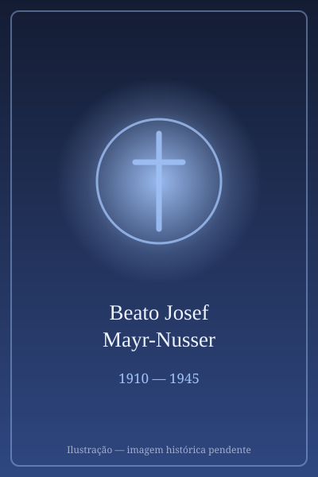

# Beato Josef Mayr-Nusser

<TextToSpeech />

> "Amanhã terei que recusar o juramento a Hitler por motivos religiosos. Confio no Senhor. Se eu não voltar, você sabe por quê."

- **Nascimento:** 27 de dezembro de 1910, Bolzano, Itália (então no Império Austro-Húngaro)
- **Morte:** 24 de fevereiro de 1945, perto de Erlangen, Alemanha
- **Beatificação:** 18 de março de 2017, pelo Papa Francisco
- **Festa Litúrgica:** 3 de outubro

## Biografia

Josef Mayr-Nusser nasceu em uma família agrícola profundamente católica no Tirol do Sul (agora Bolzano, Itália). O ambiente em que cresceu foi fortemente marcado pelos conflitos de identidade causados pela ascensão do fascismo italiano (que tentou suprimir a língua alemã e a cultura local) e mais tarde pelo nazismo.

Desde jovem, Josef envolveu-se ativamente no movimento de Ação Católica e era um ávido leitor e estudioso da Bíblia, da liturgia e dos escritos de São Tomás de Aquino e São Thomas More. Quando os nazistas ascenderam ao poder, ele rapidamente reconheceu que a ideologia racista e totalitária de Hitler era fundamentalmente incompatível com o Cristianismo. Em 1942 casou-se com Hildegard Straub e juntos tiveram um filho, Albert.

Em 1944, Josef foi convocado compulsoriamente para servir nas Waffen-SS. Ele relatou ao treinamento em Konitz (na Prússia Ocidental), mas em 4 de outubro de 1944, o dia agendado para jurar fidelidade a Adolf Hitler, Mayr-Nusser deu um passo à frente perante o General das SS e declarou com firmeza que não poderia fazer o juramento a Hitler por motivos religiosos, argumentando que a fé em Deus não permite a submissão incondicional a um ditador humano.

## Martírio

Sua recusa foi imediatamente vista como traição e insubordinação extrema. Josef foi imediatamente preso e posteriormente transferido para a prisão de Danzig, onde enfrentou julgamento, sendo acusado de derrotismo e sentenciado à morte pelo campo de concentração de Dachau.

Durante seu rigoroso encarceramento, sua saúde deteriorou-se drasticamente. Durante a transferência de trem em direção a Dachau em fevereiro de 1945, Josef sofria de desnutrição severa e disenteria. Ele morreu devido às duras condições na caixa de transporte do trem perto de Erlangen, Alemanha, a caminho do campo. Quando seu corpo foi encontrado, ele apertava um rosário e um missal. Ele é venerado como mártir, morto *in odium fidei* (por ódio à fé).

## Curiosidades

1. **Ação Católica:** Como líder da Ação Católica no Tirol do Sul, ele encorajava os jovens a buscar verdades espirituais profundas, rejeitando abertamente a propaganda do regime nazista e os ideais do fascismo muito antes da sua própria convocação.
2. **Amor pela Esposa:** Suas últimas cartas escritas da prisão para sua esposa Hildegard são de uma beleza tocante e profunda paz espiritual, declarando que o mais importante para a humanidade era não trair a própria consciência e que não nutria ódio pelos que o prenderam.
3. **Mártir da Consciência:** Assim como o Beato Franz Jägerstätter e o Beato Marcel Callo, a figura de Josef destaca a oposição dos católicos leigos comuns contra o rolo compressor das ditaduras que exigiam obediência cega.

## Cidades por onde passou

<MiracleMap :items='[
  { lat: 46.4983, lng: 11.3548, type: "nascimento", title: "Bolzano, Itália", description: "Local de nascimento e onde ele foi líder leigo da Ação Católica." },
  { lat: 54.3520, lng: 18.6466, type: "vida", title: "Danzig (hoje Gdansk, Polônia)", description: "Ele foi levado a julgamento nesta prisão após recusar o juramento na Prússia Ocidental." },
  { lat: 49.5910, lng: 11.0078, type: "morte", title: "Erlangen, Alemanha", description: "Faleceu de disenteria no trem a caminho de Dachau." }
]' />

## Impacto Hoje

Hoje, o Beato Josef Mayr-Nusser é considerado um padroeiro da liberdade de consciência, inspirando crentes e não-crentes pela sua defesa intransigente da verdade e recusa em cooperar com o mal absoluto, até mesmo sob ameaça de morte certa. Sua história ensina as futuras gerações católicas sobre a supremacia da consciência baseada no amor a Cristo diante da tirania política. Ele foi beatificado em Bolzano, perante sua família e milhares de devotos.
