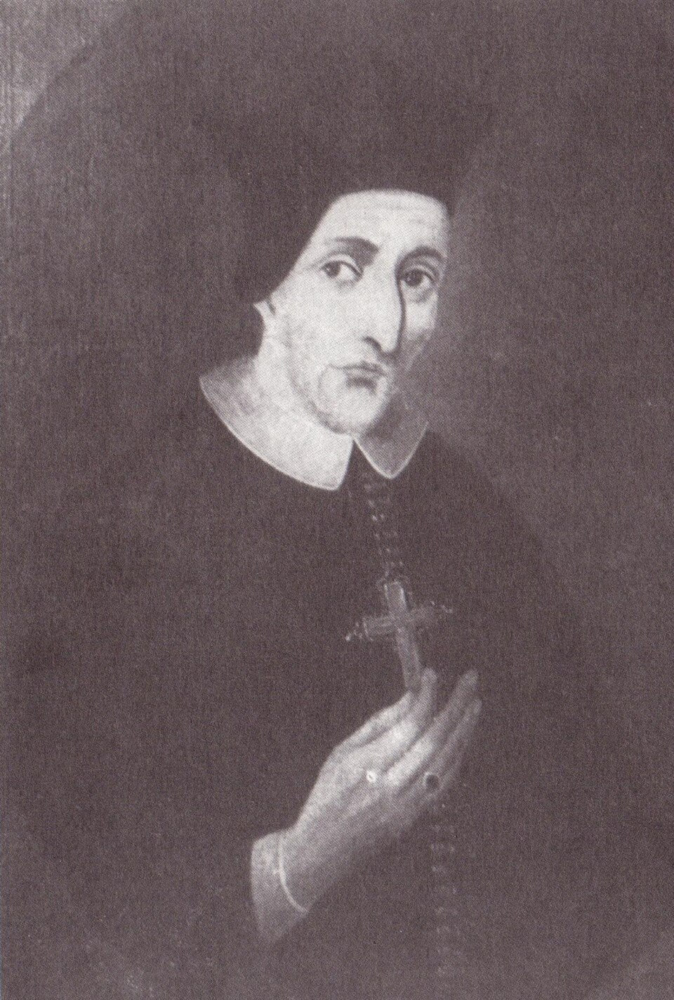

# Beato Nicolau Steno

> "Belo é o que vemos, mais belo o que conhecemos, muitíssimo mais belo o que ignoramos."

- **Nascimento:** 11 de janeiro de 1638, Copenhague, Dinamarca
- **Morte:** 25 de novembro de 1686, Schwerin, Alemanha
- **Beatificação:** 23 de outubro de 1988, pelo Papa João Paulo II
- **Festa Litúrgica:** 5 de dezembro

<TextToSpeech />

---

## Biografia

Nicolau Steno (Niels Stensen, em dinamarquês) foi um pioneiro em múltiplas ciências — anatomia, paleontologia e geologia —, além de ser uma figura marcante de conversão no século XVII. Nascido em Copenhague, numa família luterana estrita, sua curiosidade natural rapidamente se voltou para os mistérios do corpo humano e da terra.

Sua genialidade científica despontou precocemente na Holanda, onde descobriu o "Ducto de Steno" (uma glândula salivar) aos 22 anos. Mais tarde, trabalhando para a corte dos Médici em Florença, ele fez contribuições fundamentais para a geologia moderna: a estratigrafia e o princípio da superposição, demonstrando que os fósseis eram restos de organismos antigos conservados nas camadas rochosas, em uma época onde isso não era compreendido.

Apesar de seu grande sucesso científico na corte toscana, sua convivência com católicos fervorosos e sua contínua reflexão sobre o Corpo de Cristo o levaram a questionar o protestantismo de sua origem. No dia de Todos os Santos de 1667, ele converteu-se à Igreja Católica. Após a conversão, Nicolau foi ordenado sacerdote em 1675 e nomeado bispo em 1677, abdicando de sua carreira científica para pastorear e evangelizar as missões difíceis do norte da Alemanha, vivendo em extrema pobreza e ascese, gastando tudo com os necessitados até sua morte precoce aos 48 anos.

## Milagres

Em vida, seu grande "milagre" era o impressionante testemunho de abandono radical da glória terrena por amor à fé apostólica. A cura considerada para sua beatificação foi experimentada na modernidade, por fiéis que oraram por sua intercessão em casos de extrema precisão anatômica, reconhecida anos mais tarde pela comissão em Roma durante a era de João Paulo II.

## Curiosidades

1.  **Pai da Geologia:** Steno é universalmente aclamado pelos cientistas como o pai da estratigrafia moderna, mostrando que a ciência e a fé profunda podem habitar perfeitamente o mesmo intelecto.
2.  **Oração de Santo Inácio:** Inspirou-se intensamente nos ensinamentos jesuíticos após sua conversão, muitas vezes pautando seu serviço missionário pela espiritualidade inaciana, embora não tenha se tornado um jesuíta.

## Galeria de Imagens e Restaurações

| Original | Restaurada em 4K |
| :---: | :---: |
|  |  |

## Cidades por onde passou

<MiracleMap :items='[
  { lat: 55.6761, lng: 12.5683, type: "nascimento", title: "Copenhague, Dinamarca", description: "Onde nasceu e estudou as primeiras letras." },
  { lat: 43.7696, lng: 11.2558, type: "vida", title: "Florença, Itália", description: "Atuou como cientista de grande renome, convertendo-se ao catolicismo em 1667." },
  { lat: 53.6333, lng: 11.4167, type: "morte", title: "Schwerin, Alemanha", description: "Faleceu em extrema austeridade servindo como Bispo de Titiópolis." }
]' />

## Impacto Hoje

O Beato Nicolau Steno é frequentemente lembrado no dia a dia da ciência; a "Lei de Steno" ainda é ensinada nos cursos de Geologia globalmente. No campo espiritual, ele é o patrono não oficial de muitos cientistas católicos que buscam a conciliação entre a razão e a revelação, como a encíclica "Fides et Ratio" propõe. Ele deixou um imenso exemplo de humildade ao abandonar uma carreira brilhante por amor à Igreja.
