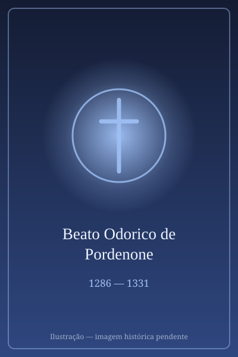

# Beato Odorico de Pordenone

> "Ide por todo o mundo e pregai o evangelho a toda criatura."

- **Nascimento:** 1286, Pordenone, Friul (Itália)
- **Morte:** 14 de janeiro de 1331, Udine (Itália)
- **Beatificação:** 2 de julho de 1755 pelo Papa Bento XIV (Culto Confirmado)
- **Festa Litúrgica:** 14 de janeiro

<TextToSpeech />

## Biografia

Odorico Mattiussi, conhecido como Odorico de Pordenone, foi um frade franciscano, missionário e grande explorador medieval da Ásia, comparável a Marco Polo. Nascido na região do Friul, na Itália, entrou para a Ordem Franciscana na juventude, no convento de Udine.

Sua sede por evangelização o levou a embarcar em uma incrível e extensa viagem missionária rumo ao Oriente por volta de 1318. Passando pela Anatólia, Pérsia e Índia, ele chegou a regiões extremas do oriente, incluindo Sri Lanka, Sumatra, Java, Bornéu e, finalmente, a China (então governada pela Dinastia Yuan). Odorico passou vários anos em Pequim (Cambalique), ajudando nas missões lideradas pelo arcebispo João de Montecorvino.

Após 12 anos e viagens por terras até então quase desconhecidas pelos europeus, Odorico retornou à Itália no final de 1329 ou início de 1330. Ele desejava ir a Avinhão para pedir ao Papa João XXII que enviasse mais missionários para o Oriente, mas adoeceu gravemente em Pisa. Ele retornou a Udine, onde ditou um extenso e detalhado relato de suas viagens ao confrade Guilherme de Solagna pouco antes de falecer, em 14 de janeiro de 1331.

## Milagres

Em vida, Odorico foi protegido milagrosamente em várias ocasiões por terras selvagens e mares perigosos durante suas viagens para pregar.

- Ele foi creditado por acalmar tempestades durante travessias marítimas arriscadas, salvando a tripulação ao evocar a proteção da Virgem Maria.
- Suportou a tortura e sobreviveu a doenças tropicais severas em suas missões indianas através de orações extasiadas.
- Imediatamente após a sua morte em Udine, inúmeras curas milagrosas foram relatadas ao redor de seu túmulo, com peregrinos atestando recuperações visuais, paralisias curadas e libertação de doenças que levaram as autoridades eclesiásticas a atestarem rapidamente a sua santidade local e, séculos mais tarde, confirmar seu culto.

## Curiosidades

- O relato de viagem de Odorico de Pordenone, ditado no leito de morte, foi uma das fontes mais ricas de informação da Europa medieval sobre a Ásia e o Extremo Oriente, incluindo descrições inéditas dos costumes chineses.
- Ele foi um dos primeiros ocidentais a descrever o costume chinês de atar os pés das mulheres.
- Foi contemporâneo do explorador Marco Polo e do famoso missionário franciscano João de Montecorvino.

## Cidades por onde passou

Odorico viajou milhares de quilômetros, uma jornada sem precedentes na época:
- Pordenone e Udine (Itália), suas cidades natais e onde entrou para a vida religiosa.
- Constantinopla, Ormuz (Pérsia), e Thane (Índia), estabelecendo contatos pelo caminho.
- Cantão e Pequim (Cambalique, China), onde evangelizou.

## Impacto Hoje

Hoje, o Beato Odorico de Pordenone é reverenciado como um padroeiro das missões longínquas, do diálogo entre o Oriente e o Ocidente, e dos exploradores. Suas crônicas continuam sendo objetos de estudo na área de história e geografia e um testemunho do zelo missionário católico de levar a fé cristã aos cantos mais desconhecidos da Terra. O santuário com suas relíquias em Udine é destino de milhares de peregrinos que oram pela paz mundial e proteção.

<MiracleMap :items='[{ lat: 45.9555, lng: 12.6565, title: "Pordenone", description: "Nasceu e passou seus primeiros anos em Pordenone, Friul.", type: "nascimento" }, { lat: 39.9042, lng: 116.4074, title: "Pequim (Cambalique)", description: "Realizou trabalho missionário na capital do Império Mongol (China).", type: "vida" }, { lat: 46.0620, lng: 13.2372, title: "Udine", description: "Voltou a Udine doente e faleceu pouco depois de ditar seu relato.", type: "morte" }]' />
