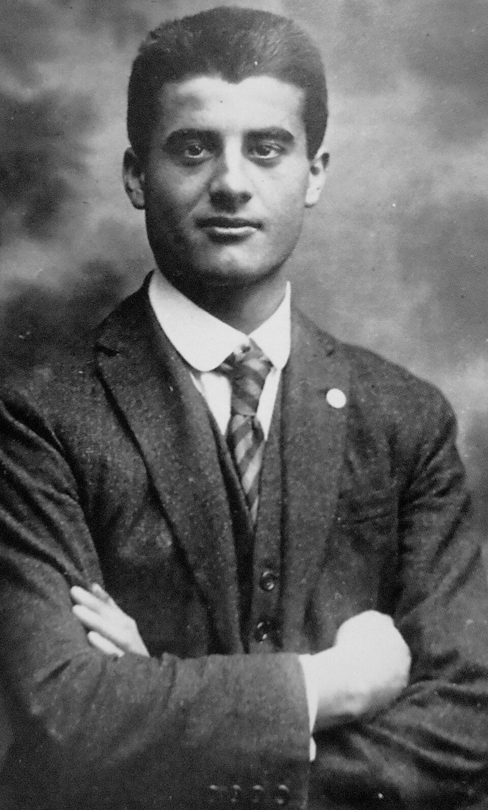

# Beato Pier Giorgio Frassati

> "O Homem das Oito Bem-aventuranças"

- **Nascimento:** 6 de abril de 1901, Turim, Itália
- **Morte:** 4 de julho de 1925, Turim, Itália
- **Beatificação:** 20 de maio de 1990, pelo Papa João Paulo II
- **Festa Litúrgica:** 4 de julho

<TextToSpeech />

---

## Biografia

Pier Giorgio Frassati nasceu em uma família rica e influente em Turim. Seu pai, Alfredo Frassati, foi fundador do jornal liberal "La Stampa" e serviu como embaixador da Itália na Alemanha. Sua mãe, Adélaïde Ametis, era pintora. Apesar do ambiente de riqueza, Pier Giorgio cresceu com um profundo senso de caridade e devoção espiritual.

Desde jovem, ele se dedicou intensamente aos pobres e doentes de Turim. Ele frequentemente doava seu próprio dinheiro, passagens de bonde e até suas roupas para os necessitados, preferindo caminhar ou usar o transporte público de terceira classe para economizar dinheiro para os pobres. Ele ingressou na Sociedade de São Vicente de Paulo, através da qual canalizava grande parte de sua ajuda caridosa.

Ele também era um ávido esportista. Amava as montanhas e frequentemente organizava excursões aos Alpes com seus amigos, a quem chamava de "Tipi Loschi" (os Tipos Suspeitos). Ele usava essas viagens para evangelizar seus amigos, combinando oração, Santa Missa e alegria. Ele era conhecido por sua energia, senso de humor e profunda vida eucarística, frequentemente participando da Adoração Noturna.

Enquanto estudava engenharia de minas (escolhida para poder trabalhar perto dos mineiros e ajudá-los), contraiu poliomielite, muito provavelmente dos pobres que assistia. A doença avançou rapidamente. Morreu aos 24 anos. Em seu leito de morte, sua última preocupação foi deixar instruções para entregar remédios a um homem pobre que ele ajudava.

O Papa João Paulo II chamou-o de "Homem das Oito Bem-aventuranças" e o propôs como modelo para a juventude.

## Milagres

O milagre que levou à sua beatificação envolveu a cura inexplicável de Domenico Sellan, em 1933. Domenico sofria de tuberculose que se espalhou para a coluna vertebral, paralisando-o. Um amigo recomendou que ele orasse a Pier Giorgio Frassati, e após começar a rezar a novena, Domenico experimentou uma cura rápida e completa, permitindo-lhe voltar a andar e viver uma vida normal. A Igreja Católica reconheceu essa cura como milagrosa após extensa investigação médica e teológica.

## Curiosidades

- O funeral de Pier Giorgio chocou seus pais ricos. Eles esperavam a elite de Turim, mas as ruas se encheram com milhares de pessoas pobres, trabalhadores, órfãos e doentes que ele havia ajudado secretamente ao longo de sua vida.
- Em 1981, seus restos mortais foram exumados e encontrados incorruptos. Foram transferidos para a Catedral de Turim.
- Ele se tornou um dos santos padroeiros mais populares da Jornada Mundial da Juventude, com suas relíquias viajando pelo mundo. O Papa Francisco frequentemente o cita como um exemplo para os jovens modernos viverem a fé com entusiasmo.
- A frase "Verso l'alto" (Rumo ao alto) é sua citação mais famosa, escrita em uma fotografia de sua última escalada, simbolizando sua busca por Deus e pelas montanhas.

## Cidades por onde passou

- **Turim, Itália:** Cidade natal onde passou a maior parte de sua vida, estudou, e realizou suas obras de caridade.
- **Pollone, Itália:** Onde a família tinha uma casa de verão, e onde ele frequentemente explorava a natureza.
- **Berlim, Alemanha:** Onde viveu por um tempo enquanto seu pai servia como embaixador, mas preferia o trabalho social às recepções diplomáticas.

## Impacto Hoje

Hoje, Pier Giorgio Frassati é um poderoso intercessor e modelo para os jovens de todo o mundo. Ele prova que a santidade não requer uma vida clerical ou isolamento do mundo moderno, mas pode ser encontrada na vida de um estudante universitário, um esportista, um amigo leal e no serviço incansável aos necessitados. Grupos de jovens, associações esportivas católicas e grupos pró-vida frequentemente o tomam como patrono.

Inúmeras associações e irmandades em todo o mundo carregam seu nome, tentando imitar seu lema "Verso l'alto". Sua beatificação gerou um interesse renovado no apostolado leigo, e sua causa de canonização continua ativa.

<MiracleMap :items='[
  { lat: 45.070, lng: 7.686, title: "Nascimento em Turim", description: "Onde nasceu e desenvolveu seu profundo apostolado.", type: "nascimento" },
  { lat: 45.070, lng: 7.686, title: "Morte em Turim", description: "Onde faleceu em consequência de poliomielite aos 24 anos.", type: "morte" },
  { lat: 45.626, lng: 8.016, title: "Pollone, Itália", description: "Local de férias da família e base para suas muitas expedições nas montanhas.", type: "vida" }
]' />
