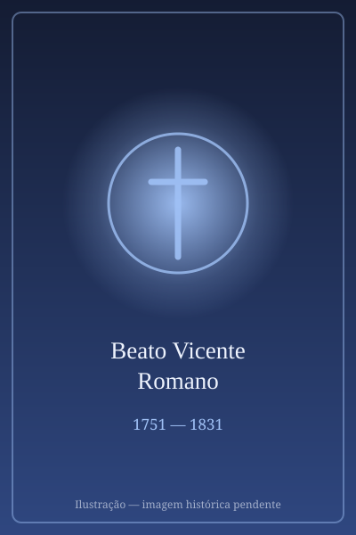

# Beato Vicente Romano

> "Fazer o bem e fazê-lo bem."

- **Nascimento:** 3 de junho de 1751, Torre del Greco, Itália
- **Morte:** 20 de dezembro de 1831, Torre del Greco, Itália
- **Beatificação:** 17 de novembro de 1963, pelo Papa Paulo VI
- **Canonização:** 14 de outubro de 2018, pelo Papa Francisco
- **Festa Litúrgica:** 20 de dezembro

<TextToSpeech />

---

## Biografia

Vicente Romano nasceu em Torre del Greco, perto de Nápoles, Itália. Ordenado sacerdote em 1775, dedicou toda a sua vida ao ministério pastoral em sua cidade natal, tornando-se o pároco da Igreja de Santa Croce.

Seu trabalho pastoral era caracterizado por um zelo incansável. Ele pregava com fervor, dedicava horas ao confessionário e era conhecido por seu profundo amor pelos pobres, órfãos e doentes. Durante a devastadora erupção do Monte Vesúvio em 1794, que destruiu grande parte de Torre del Greco, o Padre Vicente liderou os esforços de reconstrução física e espiritual da cidade, reconstruindo a própria paróquia e confortando a população aflita.

Ele inovou na pastoral criando a "Missa Prática" e organizando grupos para a educação cristã das crianças e jovens. Sua vida de intensa oração e caridade ativa lhe rendeu o título de "Padre dos Pobres".

## Milagres

A canonização do Beato Vicente Romano, agora São Vicente Romano (apesar do diretório), ocorreu após a aprovação de um milagre notável. O milagre envolveu a cura inexplicável de Renato Di Rosa, que sofria de um câncer de garganta avançado. Após invocar a intercessão de Vicente Romano e a aplicação de uma relíquia do padre na área afetada, o tumor desapareceu sem explicação médica.

## Curiosidades

1. **Reconstrutor:** Após a erupção do Vesúvio, ele não apenas liderou a reconstrução das casas e da igreja, mas também se esforçou para reconstruir a moral e a esperança de sua congregação.
2. **Apóstolo das Ruas:** Ele frequentemente saía às ruas de Torre del Greco com um crucifixo na mão para pregar a transeuntes e convidar as pessoas à conversão.
3. **Devoção Mariana:** Tinha uma forte devoção a Nossa Senhora das Dores e incentivava o Rosário entre seus paroquianos.

## Cidades por onde passou

<MiracleMap :items='[
  { lat: 40.7937, lng: 14.3683, type: "nascimento", title: "Torre del Greco, Itália", description: "Local de nascimento e onde dedicou toda a sua vida como sacerdote." },
  { lat: 40.8518, lng: 14.2681, type: "vida", title: "Nápoles, Itália", description: "Onde realizou seus estudos para o sacerdócio." },
  { lat: 40.7937, lng: 14.3683, type: "morte", title: "Torre del Greco, Itália", description: "Faleceu em sua paróquia após décadas de serviço zeloso." }
]' />

## Impacto Hoje

São Vicente Romano é lembrado como um modelo de pastor diocesano dedicado inteiramente ao seu rebanho. Seu exemplo de resiliência e liderança durante desastres naturais, combinado com seu profundo amor pelos pobres e pela evangelização nas ruas, inspira sacerdotes e leigos a se engajarem ativamente na reconstrução espiritual e social de suas próprias comunidades.
