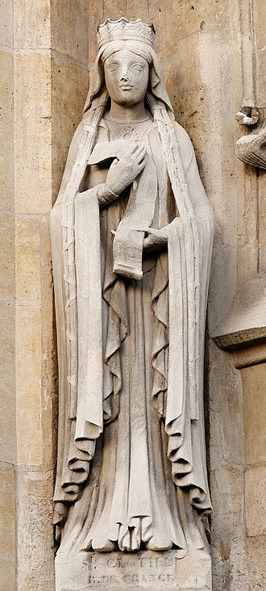

# Santa Clotilde

> "A rainha que trouxe a luz de Cristo aos Francos."

- **Nascimento:** c. 474, Lyon (Gália, atual França)
- **Morte:** 3 de junho de 545, Tours (França)
- **Canonização:** Proclamada santa pela Igreja Católica primitiva (culto imemorial)
- **Festa Litúrgica:** 3 de junho

<TextToSpeech />

---

## Biografia

Clotilde (ou Chrodechildis) nasceu em Lião (Lyon) por volta do ano 474, filha do rei burgúndio Quilperico II. Após a morte de seu pai em uma disputa pelo trono, ela foi exilada, mas sua reputação de piedade e virtude atraiu a atenção de Clóvis I, rei dos Francos. Eles se casaram em 492 ou 493.

Apesar de Clóvis ser pagão, ele permitiu que seus filhos fossem batizados. Clotilde dedicou-se fervorosamente à oração e a convencer seu marido a aceitar o cristianismo ortodoxo (católico), em oposição ao arianismo, que era comum entre outras tribos germânicas da época. A oportunidade de conversão ocorreu durante a Batalha de Tolbiac, quando Clóvis prometeu a Deus que se converteria se vencesse. Após a vitória, ele foi batizado por São Remígio, junto com cerca de 3.000 de seus soldados, marcando o início da França cristã.

Após a morte de Clóvis, Clotilde retirou-se para a abadia de São Martinho de Tours, onde passou o resto da sua vida dedicando-se às orações, aos cuidados aos pobres e enfermos, e à construção de igrejas e mosteiros, mantendo-se distante das lutas por poder travadas entre os seus filhos.

## Milagres

Numerosos milagres foram atribuídos a ela após sua morte e até mesmo em vida:
- **Água transformada em vinho:** Diz-se que, para saciar a sede de peregrinos quando o vinho acabou num mosteiro que ajudou a construir, ela orou e a água converteu-se em vinho.
- **Curas milagrosas:** Houve relatos no túmulo em Tours e mais tarde em Paris, de pessoas que recuperaram a visão, locomoção ou foram libertadas de espíritos malignos ao invocar o seu nome.

## Curiosidades

1. **A Rainha dos Francos:** Ela foi decisiva na história do catolicismo na Europa, por guiar os francos à religião católica.
2. **Reconhecimento e Patrocínio:** Santa Clotilde é padroeira das noivas, mães e pais adotivos.
3. **Morte:** Faleceu no túmulo de São Martinho em Tours, orando incessantemente, por volta de 545.

## Cidades por onde passou

Clotilde acompanhou as movimentações das cortes e de suas missões pias por cidades importantes da atual França.

<MiracleMap :items='[
  { lat: 45.7578, lng: 4.8320, type: "nascimento", title: "Lyon", description: "Local de nascimento (c. 474)." },
  { lat: 48.8566, lng: 2.3522, type: "vida", title: "Paris", description: "Cidade fundamental do reino de Clóvis e local inicial do seu enterro." },
  { lat: 47.3941, lng: 0.6848, type: "morte", title: "Tours", description: "Local do seu retiro no mosteiro, onde passou seus últimos dias e faleceu." }
]' />

## Impacto Hoje

Santa Clotilde é venerada como a mãe espiritual da França. Seu legado perdura como o de uma mulher que, por meio de seu casamento e de sua profunda fé, foi capaz de alterar o curso religioso e político de toda a Europa Ocidental. Várias igrejas na França e no mundo afora levam o seu nome, e sua vida ainda é vista como um exemplo de como uma influência amorosa e baseada em princípios religiosos pode transformar a família e a sociedade.
