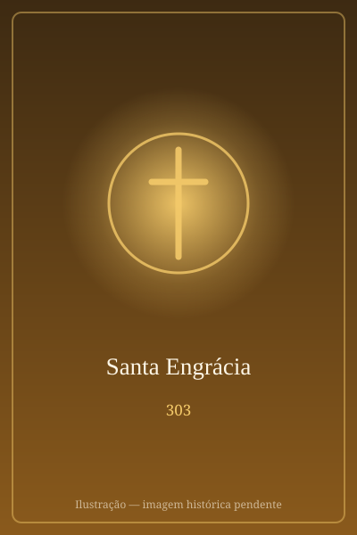

# Santa Engrácia

> "A fé é mais forte que as correntes, e o amor a Cristo, mais doce que a própria vida."

- **Nascimento:** Bracara Augusta (atual Braga), Portugal (aprox. séc III)
- **Morte:** Aprox. 303 d.C., César Augusta (atual Saragoça), Espanha
- **Canonização:** Reconhecida por antiguidade pela Igreja Primitiva
- **Festa Litúrgica:** 16 de abril

<TextToSpeech />

## Biografia

Santa Engrácia nasceu em Bracara Augusta (hoje Braga, Portugal), no seio de uma família nobre hispano-romana. Segundo a tradição, ela estava prometida em casamento a um fidalgo de Rossilhão, na Gália. Durante a sua viagem para o casamento, acompanhada por uma grande comitiva de servos e familiares (conhecidos mais tarde como os "Inumeráveis Mártires de Saragoça"), passou por César Augusta (a atual Saragoça, Espanha).

Lá, deparou-se com a violenta perseguição aos cristãos promovida pelo imperador Diocleciano, executada pelo cruel procônsul Daciano. Indignada com as atrocidades cometidas contra os seus irmãos de fé, Engrácia decidiu interceder por eles diretamente perante o governador, defendendo o cristianismo e repreendendo-o pela sua crueldade.

## Martírio

Daciano, enfurecido pela ousadia da jovem, ordenou que ela fosse imediatamente presa e submetida a torturas extremas para que renunciasse à sua fé. Ela suportou tormentos cruéis, incluindo ser flagelada, ter a carne rasgada com ganchos de ferro, e ser mutilada. Apesar do sofrimento terrível, Engrácia permaneceu firme na sua fé, recusando-se a adorar os deuses pagãos.

Segundo relatos, ela não morreu imediatamente dos ferimentos. Após suportar os tormentos, foi atirada numa masmorra sombria, onde viria a falecer devido à gravidade das feridas, com uma ferida fatal na cabeça. Por ter sobrevivido ao ápice das torturas antes de expirar, as suas feridas e o seu testemunho tornaram-se símbolos lendários da resistência cristã.

## Curiosidades

1. **Os Inumeráveis Mártires:** Os 18 companheiros da sua comitiva, assim como centenas de cristãos locais inspirados por ela, também foram mortos por Daciano e são celebrados como os Inumeráveis Mártires de Saragoça.
2. **Panteão de Panteões:** A igreja de Santa Engrácia, em Saragoça, foi construída no local do seu martírio. A cripta guarda as suas relíquias e as dos outros mártires.
3. **Panteão Nacional (Portugal):** A Igreja de Santa Engrácia, em Lisboa, uma majestosa obra barroca que demorou séculos a ser concluída (dando origem à expressão "Obras de Santa Engrácia" para algo que nunca acaba), serve hoje como o Panteão Nacional de Portugal.

## Impacto Hoje

Santa Engrácia é venerada tanto em Portugal, a sua terra natal, como na Espanha, a terra do seu martírio. Ela é um poderoso símbolo da coragem feminina e da resistência inabalável face à perseguição. O seu legado une a devoção luso-espanhola e a sua história continua a ser um testemunho eloquente do valor da liberdade religiosa.

## Cidades por onde passou

<MiracleMap :items='[
  { lat: 41.5503, lng: -8.4200, type: "nascimento", title: "Braga, Portugal", description: "Nasceu na antiga Bracara Augusta." },
  { lat: 41.6488, lng: -0.8890, type: "morte", title: "Saragoça, Espanha", description: "Enfrentou Daciano e sofreu o seu martírio na cidade de César Augusta." }
]' />
