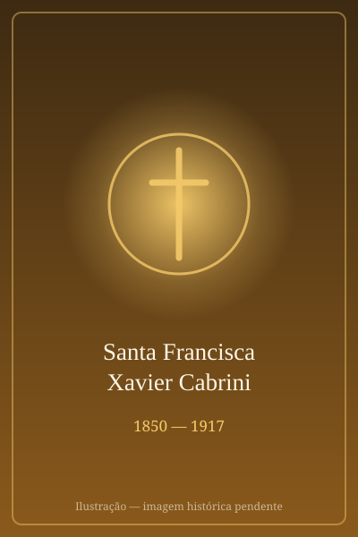

# Santa Francisca Xavier Cabrini

<TextToSpeech />

> "Nós devemos orar sem cansar, pois a salvação da humanidade não depende do sucesso material, nem nas ciências, mas em Jesus unicamente."

- **Nascimento:** 15 de julho de 1850, Sant'Angelo Lodigiano, Itália
- **Morte:** 22 de dezembro de 1917, Chicago, Estados Unidos
- **Canonização:** 7 de julho de 1946, pelo Papa Pio XII
- **Festa Litúrgica:** 22 de dezembro (e 13 de novembro nos Estados Unidos)

## Biografia

Maria Francesca Cabrini era a mais jovem de 13 filhos em uma família de agricultores e cultivadores de cerejas na Lombardia, Itália. Desde pequena, Francesca era fascinada pelas histórias dos missionários e costumava fazer barquinhos de papel, colocando neles violetas que representavam missionárias a caminho da Índia e da China. Ela obteve o certificado de professora e tentou ingressar em congregações religiosas, mas foi recusada por sua saúde frágil.

Não desistindo de seu chamado, ela fundou em 1880 as Irmãs Missionárias do Sagrado Coração de Jesus. Seu grande sonho era ir como missionária para a China, mas o Papa Leão XIII a aconselhou com as famosas palavras: "Não para o Oriente, mas para o Ocidente". Havia uma crise imensa de imigrantes italianos nas Américas, sofrendo com pobreza e discriminação.

Madre Cabrini chegou a Nova York em 1889 e, com muito esforço e total confiança na Providência Divina, passou a abrir escolas, orfanatos e hospitais. Ela atravessou o oceano diversas vezes e expandiu sua obra por toda a América, incluindo o Brasil, Argentina, Nicarágua, bem como em países europeus. Apesar de seu medo de água e da saúde delicada, ela foi uma incansável "mãe dos imigrantes", fundando 67 instituições ao longo de sua vida. Tornou-se cidadã dos Estados Unidos em 1909 e a primeira santa canonizada cidadã americana.

## Milagres

Para sua beatificação em 1938, dois milagres foram reconhecidos. Um deles foi a restauração imediata da visão e a cura de Peter Smith, que ficou cego ao nascer por um erro médico e desenvolveu uma grave pneumonia. As irmãs rezaram à Madre Cabrini e aplicaram uma relíquia, e a criança foi curada em poucas horas.

O milagre para sua canonização envolveu a cura milagrosa e imediata da Irmã Delfina Grazioli, que estava com uma doença terminal no estômago (aparentemente câncer ou peritonite grave) e em seus últimos momentos, recebendo os últimos ritos da Igreja, quando foi curada subitamente pela intercessão da Madre Cabrini.

## Curiosidades

1. **Medo de Água:** Quando jovem, Madre Cabrini quase se afogou. O incidente deixou-a com um medo crônico de grandes corpos d'água. Apesar disso, ela atravessou o Oceano Atlântico 23 vezes em sua missão e viajou extensivamente pelos rios e mares, mostrando que a fé pode superar a fobia.
2. **Cidadania:** Embora fosse fundadora internacional, sua ligação com os imigrantes americanos fez com que ela adotasse a cidadania dos Estados Unidos. Em 1946, ela se tornou a primeira cidadã dos EUA a ser canonizada santa pela Igreja Católica.
3. **Visita ao Brasil:** Madre Cabrini passou pelo Brasil em suas missões de fundar instituições para apoiar os imigrantes na América do Sul, fundando escolas no Rio de Janeiro e em São Paulo, o que mostra seu alcance verdadeiramente global.

## Cidades por onde passou

<MiracleMap :items='[
  { lat: 45.2415, lng: 9.4069, type: "nascimento", title: "Sant\u0027Angelo Lodigiano, Itália", description: "Local de nascimento e de sua juventude, onde desenvolveu o desejo de ser missionária." },
  { lat: 40.7128, lng: -74.0060, type: "vida", title: "Nova York, Estados Unidos", description: "Onde ela começou seu trabalho principal fundando orfanatos, escolas e hospitais para imigrantes." },
  { lat: -23.5505, lng: -46.6333, type: "vida", title: "São Paulo, Brasil", description: "Ela visitou a cidade em 1901 e estabeleceu escolas e orfanatos no país para auxiliar imigrantes italianos na América do Sul." },
  { lat: 41.8781, lng: -87.6298, type: "morte", title: "Chicago, Estados Unidos", description: "A cidade onde faleceu em 22 de dezembro de 1917, vítima de malária no Hospital Columbus que ela própria havia fundado." }
]' />

## Impacto Hoje

Hoje, o legado de Santa Francisca Xavier Cabrini está mais relevante do que nunca, sendo invocada como a Padroeira Universal dos Imigrantes. Sua rede global de hospitais, orfanatos e escolas permanece operando ao redor do mundo. Em tempos de debates em torno da imigração, Madre Cabrini é lembrada por sua profunda caridade, insistindo na dignidade inalienável de todos os seres humanos, independentemente de sua nacionalidade. Um filme em sua homenagem foi lançado globalmente recentemente, reafirmando seu duradouro impacto cultural e espiritual.
