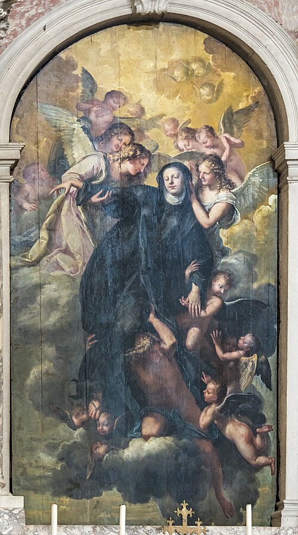

# Santa Gertrudes, a Grande

> "O amor superabundante de Deus não pode ser contido, ele se derrama sobre aqueles que o buscam."

- **Nascimento:** 6 de janeiro de 1256, Eisleben, Turíngia, Sacro Império Romano-Germânico
- **Morte:** 17 de novembro de 1302, Helfta, Saxônia, Sacro Império Romano-Germânico
- **Festa Litúrgica:** 16 de novembro
- **Canonização:** 1677, pelo Papa Clemente XII (Equipolente)

<TextToSpeech />

## Biografia

Santa Gertrudes, a Grande, também conhecida como Santa Gertrudes de Helfta, foi uma freira beneditina, mística e teóloga alemã. Nascida em 6 de janeiro de 1256 em Eisleben, Turíngia, ela entrou no mosteiro de Helfta com apenas cinco anos de idade. Lá, ela recebeu uma excelente educação, estudando latim, literatura, artes, filosofia e teologia, tornando-se uma das mulheres mais instruídas de sua época. O mosteiro era um importante centro de cultura e espiritualidade, liderado pela abadessa Gertrudes de Hackeborn.

Durante sua juventude, Gertrudes focou intensamente nos estudos seculares. No entanto, aos vinte e cinco anos, em 27 de janeiro de 1281, ela teve sua primeira visão mística de Jesus Cristo. Essa experiência marcou uma virada profunda em sua vida, levando-a a abandonar os estudos seculares em favor do estudo das Escrituras e dos Padres da Igreja. Ela descreveu essa experiência como uma "conversão", onde Cristo a chamou de volta para Ele, libertando-a da "torre da vaidade".

Gertrudes dedicou o resto de sua vida à contemplação e à escrita. Ela foi uma das primeiras grandes místicas da devoção ao Sagrado Coração de Jesus, muito antes das revelações a Santa Margarida Maria Alacoque. Suas experiências místicas foram registradas em suas obras, notavelmente o "Arauto do Amor Divino" (Legatus divinae pietatis) e os "Exercícios Espirituais". Suas visões enfatizavam a misericórdia de Deus, a humanidade de Cristo e a união da alma com o amor divino. Ela viveu uma vida de oração, ascetismo e dedicação, falecendo no mosteiro de Helfta em 1302.

## Milagres

A vida de Santa Gertrudes é marcada mais pelos profundos dons espirituais e visões místicas do que por milagres físicos espetaculares durante sua vida terrestre. No entanto, seus escritos revelam intervenções divinas e curas espirituais.

O maior "milagre" associado a Santa Gertrudes é o impacto duradouro de seus escritos, que trouxeram inúmeras almas à conversão e a uma compreensão mais profunda do amor misericordioso de Deus. A tradição relata que, após sua morte, milagres e curas foram atribuídos à sua intercessão, especialmente para aqueles que buscavam sua ajuda em momentos de aflição espiritual e doença. A propagação da devoção ao Sagrado Coração, que ela ajudou a iniciar, é vista como um milagre contínuo de renovação espiritual na Igreja.

## Curiosidades

1.  **A Única "Grande":** Santa Gertrudes é a única mulher na história da Igreja Católica a receber o título de "a Grande", um reconhecimento de sua profunda sabedoria teológica e importância espiritual.
2.  **Devoção às Almas do Purgatório:** Ela tinha uma profunda devoção às almas do Purgatório. Jesus supostamente lhe ensinou uma oração curta (a Oração de Santa Gertrudes) que, segundo a tradição, libertaria mil almas do Purgatório cada vez que fosse rezada com devoção.
3.  **Pioneira do Sagrado Coração:** Séculos antes da devoção moderna ao Sagrado Coração se popularizar, Gertrudes teve visões onde repousava a cabeça no peito de Jesus, ouvindo os batimentos de Seu coração, simbolizando Seu amor inesgotável pela humanidade.
4.  **Intelecto Brilhante:** Além de sua profunda mística, ela era uma acadêmica notável. Suas obras em latim são elogiadas por sua elegância e clareza, refletindo sua educação clássica.

## Cidades por onde passou

Embora sua vida tenha sido amplamente confinada ao ambiente monástico, sua influência e legado se espalharam muito além das paredes do mosteiro.

*   **Eisleben, Alemanha:** Cidade de seu nascimento, onde sua jornada terrena começou.
*   **Mosteiro de Helfta, perto de Eisleben:** O local onde ela viveu desde os cinco anos de idade até sua morte. Helfta era um renomado centro de misticismo feminino na época, abrigando também outras místicas notáveis, como Santa Matilde de Hackeborn.

## Impacto Hoje

Hoje, Santa Gertrudes, a Grande, é venerada como uma das figuras centrais do misticismo cristão e da teologia feminina. O "Arauto do Amor Divino" continua a ser lido por estudiosos e pessoas devotas em busca de inspiração e profundidade espiritual.

Ela é considerada a padroeira das Índias Ocidentais e invocada frequentemente pelas almas do Purgatório. Seu foco no amor incondicional e na misericórdia de Deus ressoa profundamente com os cristãos modernos, oferecendo um antídoto para visões mais rigoristas ou punitivas da religião. A devoção que ela ajudou a promover pavimentou o caminho para a centralidade do Sagrado Coração de Jesus na espiritualidade católica moderna, tornando sua voz tão relevante hoje quanto era no século XIII.

<MiracleMap :items='[
  { lat: 51.5283, lng: 11.5472, type: "nascimento", title: "Eisleben", description: "Local de nascimento de Santa Gertrudes." },
  { lat: 51.5428, lng: 11.5833, type: "morte", title: "Mosteiro de Helfta", description: "Local onde viveu a maior parte de sua vida e faleceu." },
  { lat: 51.5428, lng: 11.5833, type: "vida", title: "Revelações Místicas", description: "Local onde teve suas profundas visões do Sagrado Coração." }
]' />