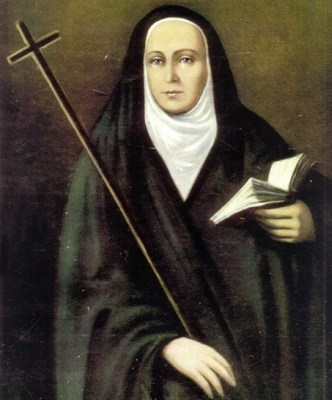

# Santa Mama Antula (María Antonia de Paz y Figueroa)

> "A paciência é o escudo das almas fortes; ela vence as adversidades e não se deixa perturbar."

- **Nascimento:** 1730, Silípica, Santiago del Estero, Argentina
- **Morte:** 7 de março de 1799, Buenos Aires, Argentina
- **Canonização:** 11 de fevereiro de 2024, pelo Papa Francisco
- **Festa Litúrgica:** 7 de março

<TextToSpeech />

---

## Biografia

María Antonia de Paz y Figueroa, carinhosamente conhecida como "Mama Antula" (Mãezinha Antula, no idioma quíchua), nasceu em 1730 em Silípica, na província de Santiago del Estero, Argentina. Pertencente a uma família abastada de colonos, aos 15 anos de idade fez um voto de virgindade e optou por não se casar nem se juntar a um convento, mas sim vestir o hábito negro das mulheres consagradas conhecidas como "beatas", dedicando-se inteiramente à oração e ao serviço aos necessitados.

Quando os jesuítas foram expulsos do Império Espanhol em 1767 pelo Rei Carlos III da Espanha, ela assumiu a responsabilidade de manter vivos os exercícios espirituais de Santo Inácio de Loyola. Caminhando descalça por milhares de quilômetros, atravessou diversas províncias argentinas, incluindo Santiago del Estero, Tucumán, Salta, Jujuy, Catamarca, La Rioja, Córdoba e, finalmente, Buenos Aires, promovendo retiros que atraíam milhares de pessoas de todas as classes sociais.

Sua missão não foi fácil; enfrentou incompreensão, acusações e a desconfiança inicial das autoridades civis e eclesiásticas. No entanto, sua fé inabalável, humildade e carisma transformaram os retiros em centros de renovação espiritual e reconciliação social. Em Buenos Aires, ela fundou a Santa Casa de Exercícios Espirituais, que se tornou um marco na história religiosa do país e foi frequentada por figuras proeminentes da independência argentina.

## Milagres

A canonização de Mama Antula ocorreu após o reconhecimento de dois milagres notáveis:

1. **A cura de Irmã Rosa Vanina (1904):** Uma freira que sofria de colecistite aguda com peritonite generalizada e falência de múltiplos órgãos, sem possibilidade de cura segundo os médicos. Após invocar Mama Antula, ela recuperou-se milagrosamente.
2. **A cura de Claudio Perusini (2017):** Um homem que sofreu um acidente vascular cerebral isquêmico grave, resultando em coma profundo, septicemia, choque resistente, falência de múltiplos órgãos e dano cerebral severo e irreversível. Sua esposa, amigos e o Bispo rezaram a Mama Antula, e ele experimentou uma recuperação completa, retornando a uma vida normal.

## Curiosidades

1. **A Primeira Santa Argentina:** Ela é a primeira mulher nascida na Argentina a ser canonizada, e por um Papa argentino, o Papa Francisco.
2. **Andarilha da Fé:** Estima-se que ela tenha caminhado descalça cerca de 4.000 a 5.000 quilômetros para organizar os retiros espirituais e espalhar a fé.
3. **Influência Histórica:** Muitas figuras importantes da Revolução de Maio de 1810, que levou à independência da Argentina, como Manuel Belgrano e Cornelio Saavedra, participaram de seus retiros na Santa Casa de Exercícios.

## Cidades por onde passou

<MiracleMap :items='[
  { lat: -27.9734, lng: -64.1205, type: "nascimento", title: "Silípica, Argentina", description: "Sua cidade natal, onde nasceu e cresceu em uma família influente." },
  { lat: -27.7833, lng: -64.2667, type: "vida", title: "Santiago del Estero, Argentina", description: "Onde começou sua vida de consagração e iniciou sua missão após a expulsão dos jesuítas." },
  { lat: -31.4201, lng: -64.1888, type: "vida", title: "Córdoba, Argentina", description: "Uma das principais cidades onde organizou os retiros inacianos." },
  { lat: -34.6037, lng: -58.3816, type: "morte", title: "Buenos Aires, Argentina", description: "Onde fundou a Santa Casa de Exercícios Espirituais e faleceu em 1799." }
]' />

## Impacto Hoje

Santa Mama Antula é um modelo de liderança feminina na Igreja e um exemplo de dedicação aos esquecidos e marginalizados. Seu legado perdura não apenas através da Santa Casa de Exercícios Espirituais em Buenos Aires, que ainda existe e funciona, mas também em sua mensagem de fé perseverante diante das adversidades. Ela demonstrou que, mesmo em tempos de crise institucional, os leigos podem desempenhar um papel fundamental na renovação e propagação da fé, promovendo a igualdade social e espiritual.
