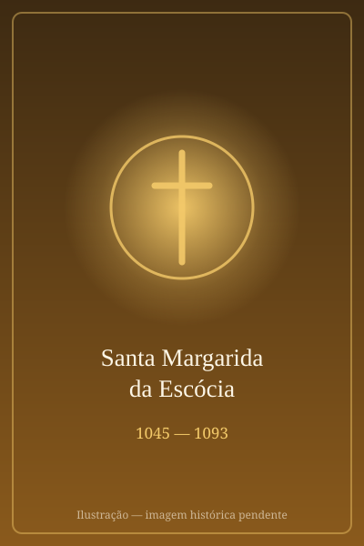

# Santa Margarida da Escócia

> "A rainha que civilizou um reino com caridade e fé."

- **Nascimento:** c. 1045, Mecseknádasd, Reino da Hungria
- **Morte:** 16 de novembro de 1093, Edimburgo, Escócia
- **Canonização:** 1250 pelo Papa Inocêncio IV
- **Festa Litúrgica:** 16 de novembro

<TextToSpeech />

---

## Biografia

Santa Margarida nasceu na Hungria, por volta de 1045, filha do príncipe inglês Eduardo, o Exilado, e da princesa Ágata. Ela passou a primeira infância na corte húngara, que era fortemente influenciada pelos valores cristãos, onde cultivou uma devoção profunda. Com o retorno de seu pai à Inglaterra, a família se estabeleceu lá, mas após a invasão normanda em 1066, precisou fugir. Seu navio, desviado por uma tempestade, acabou chegando à Escócia, onde o rei Malcolm III os acolheu.

Malcolm se encantou com a beleza, inteligência e piedade de Margarida, casando-se com ela em 1070. Como rainha, Margarida transformou a Escócia. Ela não apenas influenciou as políticas do reino em favor da justiça e da caridade, mas também reformou a Igreja escocesa, introduzindo práticas litúrgicas romanas e promovendo a educação e as artes. Teve oito filhos, educando-os com rigor na fé e nos deveres morais. Margarida faleceu em 16 de novembro de 1093, no Castelo de Edimburgo, três dias após receber a notícia da morte de seu marido e de seu filho mais velho em batalha.

## Vida Pessoal e Espiritualidade

Margarida foi uma rainha excepcionalmente devota, conhecida por sua profunda vida de oração e práticas ascéticas rigorosas. Ela dedicava grande parte do seu tempo à leitura das Sagradas Escrituras e aos cuidados dos pobres, órfãos e doentes. Relata-se que ela lavava os pés dos mendigos e os alimentava antes de tomar sua própria refeição. Sua influência sobre o marido, Malcolm, foi notável; embora analfabeto, ele tinha as joias incrustadas em seus livros de oração e as beijava em sinal de respeito.

## Milagres

Os milagres atribuídos a Santa Margarida centram-se em curas de pessoas que visitaram o seu túmulo na Abadia de Dunfermline, bem como intervenções em favor dos necessitados. Durante sua vida, um milagre frequentemente relatado é o resgate intacto de seu livro de Evangelhos decorado, que havia caído em um rio, e foi retirado das águas sem nenhum dano, o que foi considerado um sinal da proteção divina sobre sua devoção. Além disso, muitos testemunharam curas de doenças inexplicáveis na Escócia, graças à sua intercessão.

## Curiosidades

1. **Evangelho Milagroso:** O "Evangelho de Margarida", o livro que caiu na água e foi recuperado intacto, ainda existe e está preservado na Biblioteca Bodleiana, em Oxford.
2. **Capela de Santa Margarida:** A pequena Capela de Santa Margarida, no Castelo de Edimburgo, foi construída por seu filho, o Rei David I, e é o edifício mais antigo ainda de pé em Edimburgo.
3. **Mãe de Reis e Rainhas:** Três de seus filhos tornaram-se reis da Escócia (Edgar, Alexandre I e David I), e sua filha Matilde casou-se com o rei Henrique I da Inglaterra.
4. **Travessia da Rainha:** O "Queen's Ferry" (Ferry da Rainha), um ponto de travessia do rio Forth, recebeu esse nome porque Margarida instituiu ali um serviço de barcos gratuito para os peregrinos que iam a St Andrews.

## Cidades por onde passou

Margarida viveu na Hungria, na corte inglesa e, após sua fuga, estabeleceu-se e governou a Escócia, especialmente ao redor de Edimburgo e Dunfermline.

<MiracleMap :items='[
  { lat: 46.2238, lng: 18.4719, type: "nascimento", title: "Mecseknádasd, Hungria", description: "Local de nascimento durante o exílio de seu pai." },
  { lat: 56.0718, lng: -3.4636, type: "vida", title: "Abadia de Dunfermline, Escócia", description: "Abadia fundada por Margarida, que também serviu como local de seu sepultamento." },
  { lat: 55.9486, lng: -3.1999, type: "morte", title: "Castelo de Edimburgo, Escócia", description: "Local de sua morte, em 16 de novembro de 1093." }
]' />

## Impacto Hoje

Santa Margarida da Escócia é lembrada como a Padroeira da Escócia. Sua festa é celebrada com devoção, e sua vida continua a ser um modelo de como a fé e a caridade podem moldar e elevar uma nação. A fusão da espiritualidade cristã com a responsabilidade cívica, promovida por ela, deixou um legado duradouro na cultura e na história escocesa. Escolas, hospitais e paróquias levam seu nome ao redor do mundo.
