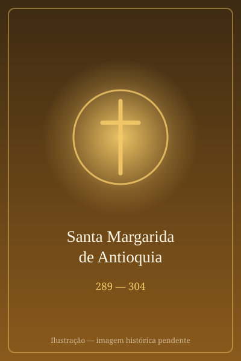

# Santa Margarida de Antioquia

> "Mártir da pureza e da fé, que venceu o dragão com a cruz de Cristo."

- **Nascimento:** 289 d.C., Antioquia da Pisídia, Ásia Menor (atual Turquia)
- **Morte:** 304 d.C., Antioquia da Pisídia
- **Canonização:** Reconhecida como Santa nos primeiros séculos (Pré-Congregação)
- **Festa Litúrgica:** 20 de julho

<TextToSpeech />

---

## Biografia

Margarida de Antioquia, também conhecida como Marina na Igreja Oriental, é uma das virgens mártires mais reverenciadas da antiguidade. Nascida em Antioquia da Pisídia, era filha de um sacerdote pagão chamado Edesius. Após a morte prematura de sua mãe, Margarida foi criada por uma ama cristã que a educou na fé cristã, vivendo a cerca de quinze milhas da cidade.

Ao abraçar o cristianismo e dedicar sua virgindade a Cristo, Margarida provocou a ira de seu pai, que a expulsou de casa. Ela passou a viver com sua ama, ajudando-a a cuidar das ovelhas. Certo dia, Olybrius, o governador romano, viu Margarida e ficou cativado por sua beleza. Ele quis casar-se com ela ou tomá-la como concubina, desde que ela renunciasse ao cristianismo.

Margarida recusou firmemente, declarando que já havia se entregado a Jesus Cristo. Enfurecido com a rejeição e com a recusa em adorar os deuses pagãos, Olybrius a prendeu. Durante seu encarceramento, Margarida foi submetida a horríveis torturas, mas suportou tudo com fé inabalável.

Após sobreviver miraculosamente às torturas, ela foi finalmente decapitada. Sua devoção espalhou-se rapidamente, tornando-a uma das santas mais populares da Idade Média, invocada especialmente por mulheres em trabalho de parto.

## Milagres

O milagre mais célebre associado a Santa Margarida, embora considerado por muitos estudiosos modernos como uma lenda alegórica, é seu encontro com o demônio. Conta-se que, enquanto estava presa, o diabo lhe apareceu sob a forma de um terrível dragão e a engoliu. No entanto, Margarida carregava uma cruz, que irritou as entranhas do monstro, fazendo com que ele estourasse e a libertasse ilesa.

Outros relatos indicam que ela foi lançada no fogo e, em seguida, em um grande caldeirão de água fervente, saindo de ambas as provações completamente ilesa. Milhares de pessoas teriam se convertido ao presenciar sua fé e os milagres durante seu martírio.

## Curiosidades

- **Santas Auxiliadoras:** Santa Margarida é uma das catorze "Santas Auxiliadoras", um grupo de santos particularmente invocados contra várias doenças no final da Idade Média.
- **Santa Joana d'Arc:** Margarida foi uma das santas cujas "vozes" instruíram e guiaram Santa Joana d'Arc.
- **Padroeira:** É amplamente invocada como padroeira das mulheres grávidas e do parto seguro, devido à lenda de ter saído "ilesa do ventre" do dragão.
- **Iconografia:** Geralmente é representada como uma bela jovem escapando ou esmagando um dragão, frequentemente segurando uma cruz nas mãos.

## Cidades por onde passou

Sua vida, ministério e martírio limitaram-se à região de Antioquia da Pisídia.

<MiracleMap :items='[
  { lat: 38.3039, lng: 31.4085, type: "nascimento", title: "Antioquia da Pisídia", description: "Local de seu nascimento." },
  { lat: 38.3039, lng: 31.4085, type: "morte", title: "Antioquia da Pisídia", description: "Local do seu martírio sob Diocleciano." }
]' />

## Impacto Hoje

Embora o Concílio Vaticano II tenha levantado questões sobre a historicidade de partes de sua lenda, removendo-a temporariamente do Calendário Romano Geral, sua popularidade histórica e espiritualidade perduram.

Hoje, Santa Margarida é lembrada por sua coragem inabalável diante do poder e da opressão. Seu legado continua a inspirar cristãos a permanecerem firmes em sua fé, lembrando aos devotos que, com Cristo, as forças do mal podem ser superadas, e continua sendo uma figura reconfortante para muitas gestantes.
