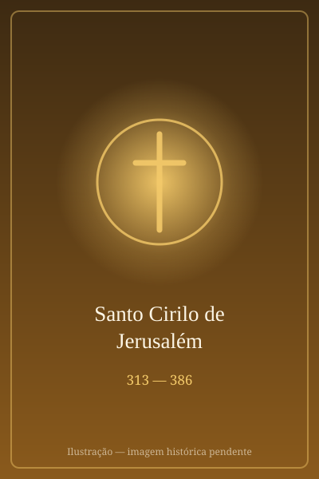

# Santo Cirilo de Jerusalém

> "Aquele que prepara a alma se purifica a si mesmo para estar pronto a receber o hóspede divino."

- **Nascimento:** c. 313, Jerusalém
- **Morte:** 18 de março de 386, Jerusalém
- **Canonização:** Proclamado Doutor da Igreja pelo Papa Leão XIII em 1883.
- **Festa Litúrgica:** 18 de março

<TextToSpeech />

---

## Biografia

Cirilo nasceu em Jerusalém ou nos seus arredores, por volta do ano 313, mesmo ano em que o imperador Constantino concedeu a liberdade de culto aos cristãos através do Édito de Milão. Pouco se sabe sobre a sua juventude, mas foi educado nas Sagradas Escrituras e foi ordenado sacerdote pelo bispo de Jerusalém, Máximo.

Por volta de 348, foi encarregado de instruir os catecúmenos (aqueles que se preparavam para o batismo) em Jerusalém. As suas "Catequeses", um conjunto de 24 instruções dirigidas aos candidatos ao batismo, são um dos tesouros mais importantes da Igreja Antiga, oferecendo uma visão detalhada da liturgia, sacramentos e teologia da época.

Tornou-se Bispo de Jerusalém em 350. O seu episcopado foi marcado por intensas controvérsias teológicas, especialmente com a heresia ariana, que negava a divindade de Jesus Cristo. Cirilo foi um firme defensor da fé do Concílio de Niceia, o que lhe valeu o exílio por três vezes, instigado por imperadores e bispos arianos, perfazendo cerca de 16 anos longe da sua diocese.

Apesar das perseguições e calúnias, manteve-se fiel à fé ortodoxa e participou do Primeiro Concílio de Constantinopla (381), onde a sua ortodoxia foi plenamente reconhecida.

## Milagres

Em 351, pouco depois de Cirilo se tornar bispo, ocorreu um fenómeno celestial em Jerusalém: o aparecimento de uma cruz luminosa sobre a cidade, que se estendia do Calvário ao Monte das Oliveiras. Este evento, relatado pelo próprio Cirilo numa carta ao imperador Constâncio II, foi interpretado como um sinal de encorajamento e milagre da providência. Além disso, muitos milagres de conversão e firmeza na fé são atribuídos aos seus ensinamentos.

## Curiosidades

1.  **Catequeses Mistagógicas:** As suas últimas cinco catequeses, chamadas "mistagógicas", eram dadas durante a semana da Páscoa aos recém-batizados, explicando os sacramentos que tinham acabado de receber (Batismo, Confirmação e Eucaristia) de forma profunda e poética.
2.  **Visão Teológica:** Cirilo enfatizava a presença real de Cristo na Eucaristia com palavras muito claras e precisas para a sua época, influenciando toda a teologia sacramental posterior.
3.  **Conciliador:** Apesar de ser exilado por arianos, as suas palavras e atitudes procuravam sempre a unidade da Igreja, usando termos conciliatórios sempre que possível, sem comprometer a verdade da fé.

## Cidades por onde passou

Cirilo passou a maior parte da sua vida em Jerusalém, mas o exílio levou-o a outras regiões, como Tarso e lugares no Império Oriental.

<MiracleMap :items='[
  { lat: 31.7683, lng: 35.2137, type: "nascimento", title: "Jerusalém", description: "Local de nascimento e ministério pastoral de Cirilo (c. 313)." },
  { lat: 36.9167, lng: 34.8833, type: "vida", title: "Tarso (atual Turquia)", description: "Local de refúgio durante um dos seus períodos de exílio (c. 358)." },
  { lat: 31.7683, lng: 35.2137, type: "morte", title: "Jerusalém", description: "Local da sua morte, após anos de pastoreio e exílios (18 de março de 386)." }
]' />

## Impacto Hoje

Santo Cirilo de Jerusalém é lembrado principalmente como um dos maiores catequistas da história da Igreja. As suas "Catequeses" continuam a ser lidas e estudadas como uma fonte fundamental para compreender a fé e a liturgia da Igreja Primitiva. Como Doutor da Igreja, o seu ensinamento sobre os sacramentos, especialmente o Batismo e a Eucaristia, permanece atual e inspira a catequese em todo o mundo cristão. O seu exemplo de firmeza na verdade, mesmo perante o sofrimento e o exílio, inspira cristãos perseguidos ainda hoje.
