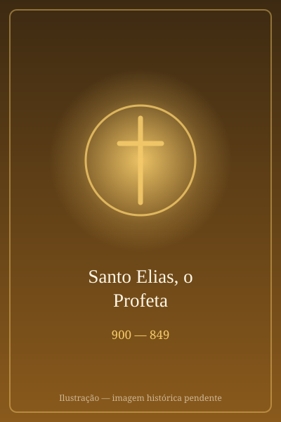

# Santo Elias, o Profeta

> "O Senhor vive, em cuja presença eu estou"

- **Nascimento:** c. 900 a.C., Tisbé (Gileade)
- **Morte:** Assunção aos céus no Rio Jordão, c. 849 a.C.
- **Canonização:** Culto imemorial
- **Festa Litúrgica:** 20 de julho

<TextToSpeech />

## Biografia

Santo Elias, um dos maiores profetas do Antigo Testamento, nasceu em Tisbé, na região de Gileade. Seu nome significa "O Senhor é o meu Deus", o que resumia sua missão de combater a idolatria em Israel durante o reinado de Acabe e Jezabel. Ele defendeu o monoteísmo e a fidelidade à aliança com Javé.

Elias é conhecido por seus confrontos com os profetas de Baal no Monte Carmelo, onde desafiou-os a provar o poder de seus deuses. Após o fracasso deles, Elias invocou Javé, que enviou fogo do céu, consumindo o sacrifício. Esse evento restaurou temporariamente a fé do povo em Deus. Elias também previu uma grande seca, que durou três anos, e a ressurreição do filho de uma viúva em Sarepta, a quem ele curou milagrosamente.

No fim de sua vida terrena, Elias não experimentou a morte física como a maioria das pessoas. Em vez disso, foi arrebatado em um redemoinho aos céus em uma carruagem de fogo puxada por cavalos flamejantes, deixando seu manto para seu discípulo Eliseu. Ele também apareceu ao lado de Moisés durante a Transfiguração de Jesus no Monte Tabor, consolidando seu papel como uma figura central na tradição profética.

## Milagres

A vida de Elias é marcada por inúmeros milagres, incluindo:

- **A Provisão de Sarepta:** Durante a seca, multiplicou a farinha e o azeite da viúva de Sarepta, garantindo que nunca acabassem até a chuva voltar.
- **A Ressurreição do Filho da Viúva:** Quando o filho da viúva morreu, Elias orou a Deus e o jovem ressuscitou, um dos primeiros relatos bíblicos de ressurreição.
- **O Fogo no Carmelo:** Invocou o fogo do céu no Monte Carmelo para consumir o sacrifício e provar que Javé era o único Deus verdadeiro.

## Curiosidades

1. **A Ordem dos Carmelitas:** Santo Elias é considerado o pai espiritual da Ordem dos Carmelitas, que se originou no Monte Carmelo, onde ele teve o confronto com os profetas de Baal.
2. **Carruagem de Fogo:** Elias é frequentemente retratado subindo ao céu em uma carruagem de fogo, um evento que consolidou sua importância não apenas no judaísmo e cristianismo, mas também no islamismo.
3. **Padrão Profético:** Ele é considerado o modelo por excelência do profetismo bíblico, inspirando figuras como João Batista.

## Cidades por onde passou

Elias teve uma vida peregrina, e algumas das principais cidades e locais de sua jornada incluem:

- **Tisbé:** Sua cidade natal em Gileade.
- **Monte Carmelo:** Onde enfrentou e derrotou os profetas de Baal.
- **Sarepta (Zarefate):** Onde realizou o milagre da farinha e do azeite, e ressuscitou o filho da viúva.
- **Rio Jordão:** O local de sua ascensão aos céus em um redemoinho.

## Impacto Hoje

Hoje, Santo Elias é reverenciado por cristãos, judeus e muçulmanos como um profeta fervoroso e um exemplo de zelo ardente por Deus. No catolicismo, ele inspirou o desenvolvimento do monaquismo carmelita e é um ícone de oração contemplativa combinada com a ação profética em defesa da verdade. Sua memória continua viva nas comunidades do Oriente Médio, onde igrejas e santuários celebram sua vida e legado.

<MiracleMap :items='[
  { lat: 32.55, lng: 35.85, type: "nascimento", title: "Tisbé, Gileade", description: "Região de nascimento de Elias." },
  { lat: 31.838, lng: 35.546, type: "morte", title: "Rio Jordão", description: "Local próximo onde ocorreu a ascensão aos céus." },
  { lat: 32.733, lng: 35.05, type: "vida", title: "Monte Carmelo", description: "Local do confronto com os profetas de Baal." },
  { lat: 33.456, lng: 35.295, type: "milagre", title: "Sarepta (Zarefate)", description: "Local do milagre da farinha, do azeite e da ressurreição." }
]' />
