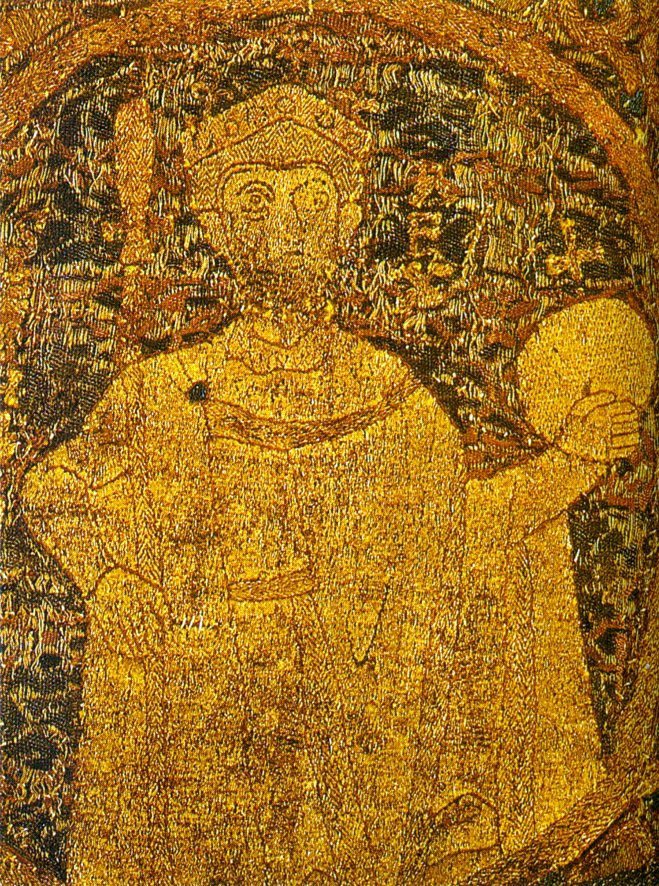

# Santo Estêvão da Hungria

> "Rei, Apóstolo e Construtor de uma Nação"

- **Nascimento:** 975, Esztergom, Principado da Hungria
- **Morte:** 15 de agosto de 1038, Székesfehérvár, Reino da Hungria
- **Canonização:** 20 de agosto de 1083, pelo Papa Gregório VII
- **Festa Litúrgica:** 16 de agosto

<TextToSpeech />

---

## Biografia

Nascido com o nome de Vajk em Esztergom, Santo Estêvão era filho do Grão-Príncipe Géza da Hungria. Ele foi batizado ainda jovem com o nome de Estêvão, em homenagem a Santo Estêvão Protomártir. Em 997, sucedeu seu pai e consolidou seu poder após uma série de conflitos com parentes pagãos.

Em 1000, o Papa Silvestre II enviou-lhe uma coroa, e no Natal daquele ano (ou no dia 1º de janeiro de 1001), ele foi coroado o primeiro rei da Hungria, estabelecendo assim o Reino da Hungria. Estêvão dedicou sua vida a cristianizar seu povo, estabelecendo uma sólida estrutura para a Igreja húngara com dioceses, mosteiros e leis que encorajavam a prática do cristianismo e a construção de igrejas.

Seu reinado foi marcado pela paz, prosperidade e um profundo compromisso com a justiça e a religião. Ele também foi um grande defensor dos peregrinos que viajavam para Jerusalém e para outras partes, garantindo-lhes passagem segura por seus domínios.

## Milagres

Inúmeros milagres foram atribuídos à sua intercessão, tanto durante sua vida quanto após sua morte. Um dos milagres mais conhecidos, após sua morte, envolve a preservação incorrupta de sua mão direita. A "Santa Direita" é reverenciada como uma relíquia sagrada e é creditada por curar várias doenças e trazer paz espiritual àqueles que oram diante dela.

Outros relatos incluem curas milagrosas de pessoas enfermas que visitavam seu túmulo em Székesfehérvár. O processo de canonização, promovido pelo Rei São Ladislau I da Hungria, reuniu testemunhos desses eventos, consolidando a santidade do rei.

## Curiosidades

- A "Santa Direita", mão direita incorrupta do rei, é a relíquia mais sagrada da Hungria e é exibida todos os anos no dia 20 de agosto, feriado nacional húngaro e festa litúrgica no calendário húngaro.
- Ele ofereceu seu país à proteção da Virgem Maria antes de morrer, tornando a Hungria o primeiro país a ser dedicado a Nossa Senhora (a "Regnum Marianum").
- Suas "Admoestações", um conjunto de ensinamentos morais escritos para seu filho, o Príncipe Américo (que também foi canonizado), são um tratado de sabedoria e bom governo que inspirou muitas gerações.
- A coroa usada por Estêvão, conhecida como a "Sagrada Coroa Húngara", tornou-se o símbolo supremo da nação e de sua constituição.

## Galeria de Imagens e Restaurações

| Original | Restaurada em 4K |
| :---: | :---: |
|  |  |

## Cidades por onde passou

- **Esztergom, Hungria:** Local de seu nascimento, batismo e onde, mais tarde, foi coroado rei.
- **Székesfehérvár, Hungria:** Fundou a cidade como o centro político e espiritual de seu reino, construindo a grande basílica onde foi sepultado.
- **Buda (hoje Budapeste), Hungria:** Embora o desenvolvimento principal da cidade seja posterior, Estêvão viajou por toda essa região para consolidar seu reino.

## Impacto Hoje

Hoje, Santo Estêvão é o padroeiro principal e reverenciado por todo o povo húngaro. O feriado nacional da Hungria, em 20 de agosto, comemora a transferência de suas relíquias e sua canonização. Ele é considerado não apenas um líder espiritual, mas o fundador do Estado húngaro.

A Basílica de Santo Estêvão em Budapeste, uma das igrejas mais importantes do país, guarda sua relíquia (a Santa Direita) e atrai milhares de peregrinos e turistas todos os anos. Seu legado como um governante justo que buscou o bem de seu povo sob os ensinamentos cristãos permanece vivo, sendo lembrado como um modelo de rei e santo católico na Europa Central.

<MiracleMap :items='[
  { lat: 47.797, lng: 18.739, title: "Nascimento em Esztergom", description: "Local onde nasceu e foi batizado Santo Estêvão.", type: "nascimento" },
  { lat: 47.190, lng: 18.411, title: "Morte em Székesfehérvár", description: "Local de sua morte e sepultamento na basílica que ele fundou.", type: "morte" },
  { lat: 47.500, lng: 19.054, title: "Basílica de Santo Estêvão, Budapeste", description: "Onde hoje se guarda a famosa relíquia da Santa Direita.", type: "vida" }
]' />
