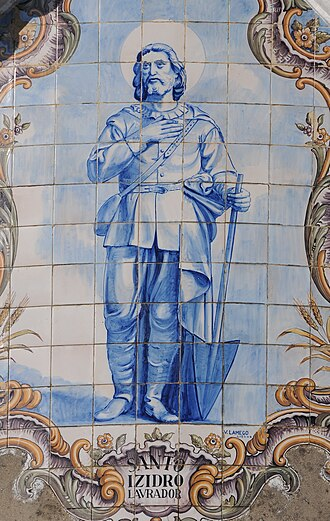

# Santo Isidro Lavrador

> "Padroeiro dos agricultores e modelo de santidade na vida cotidiana e no trabalho do campo."

- **Nascimento:** c. 1070 (Madri, Espanha)
- **Morte:** 15 de maio de 1130 (Madri, Espanha)
- **Canonização:** 12 de março de 1622
- **Festa Litúrgica:** 15 de maio

---

<TextToSpeech />

## Biografia

Santo Isidro Lavrador nasceu em Madri, na Espanha, por volta do ano 1070. De origem humilde, ele passou grande parte de sua vida trabalhando como agricultor (lavrador) nas terras de um rico proprietário de terras, chamado João de Vargas. Isidro era conhecido por sua profunda devoção a Deus, que nunca interferiu no cumprimento de seus deveres, mas sim os elevou.

Ele se casou com Maria de la Cabeza, que também foi reconhecida mais tarde como santa pela devoção e vida virtuosa que compartilharam. O casal teve um filho que faleceu na juventude, tragédia que suportaram com imensa fé, decidindo dedicar ainda mais suas vidas à oração e à caridade.

A vida de Isidro foi marcada por uma piedade extraordinária. Ele costumava acordar bem cedo todos os dias para assistir à Santa Missa antes de iniciar seu exaustivo trabalho no campo. Frequentemente, os outros trabalhadores reclamavam com João de Vargas de que Isidro chegava atrasado para o trabalho por causa de suas práticas religiosas, mas a colheita em sua parte do campo sempre era misteriosamente tão abundante ou maior que as demais.

Ele sempre demonstrou compaixão e caridade para com os necessitados e até para com os animais, dividindo seu alimento escasso com os pobres que encontrava. Sua vida é um poderoso lembrete de que a santidade pode ser alcançada por meio do trabalho manual simples, feito com amor e oração profunda.

## Milagres

* **Os Anjos Trabalhando:** Certa vez, quando Isidro estava imerso em oração e aparentemente atrasado, João de Vargas foi inspecionar seu trabalho e viu anjos guiando os bois e arando o campo no lugar de Isidro.
* **O Milagre da Água:** Durante um período de seca severa, Isidro bateu com seu cajado no chão seco, e uma nascente jorrou milagrosamente para matar a sede do seu patrão e de outros trabalhadores.
* **O Milagre do Trigo:** No inverno, enquanto Isidro levava grãos ao moinho, ele parou para alimentar pombos famintos com parte de seu trigo. Apesar dessa caridade aparentemente imprudente, o saco de grãos ao chegar no moinho produziu muito mais farinha que o esperado.
* **Cura do Filho:** Segundo a tradição, o filho de Isidro caiu em um poço profundo e afogou-se. Através das fervorosas orações de Isidro e de sua esposa Maria, a água do poço subiu até a borda, trazendo a criança milagrosamente sã e salva.
* **Corpo Incorrupto:** Mais de 40 anos após sua morte, seu corpo foi exumado e encontrado intacto e incorrupto. Hoje ele é venerado na Igreja Colegiada de Santo Isidro, em Madri.

## Curiosidades

* Santo Isidro foi canonizado no mesmo dia que outros grandes santos espanhóis: Santo Inácio de Loyola, São Francisco Xavier e Santa Teresa de Ávila.
* É o santo padroeiro de Madri, e sua festa em 15 de maio é celebrada com uma imensa festividade folclórica e religiosa na cidade.
* Ele e sua esposa, Santa Maria de la Cabeza (canonizada no século XVII), são um dos raros exemplos de casais santos na Igreja.
* É reverenciado em várias partes do mundo hispânico, especialmente em comunidades rurais que dependem da agricultura.

## Galeria de Imagens e Restaurações

| Original | Restaurada em 4K |
| :---: | :---: |
|  |  |

## Cidades por onde passou

* Madri, Espanha: A cidade onde nasceu, viveu, trabalhou e morreu. Sua vida esteve quase inteiramente ligada às terras nos arredores desta cidade.

## Impacto Hoje

O impacto de Santo Isidro hoje permanece imenso, especialmente entre os trabalhadores rurais, fazendeiros e moradores de cidades da América Latina, Filipinas e Espanha. Ele é frequentemente invocado para pedir boas colheitas, clima favorável (chuva) e para encontrar dignidade e significado no trabalho árduo diário. Seu legado sublinha a universalidade do chamado à santidade em todas as vocações, mostrando que o amor a Deus no dever simples transforma o mundo.

<MiracleMap :items='[
  { lat: 40.4168, lng: -3.7038, title: "Nascimento em Madri", description: "Santo Isidro nasceu em Madri, onde trabalhou a vida toda como lavrador.", type: "nascimento" },
  { lat: 40.4125, lng: -3.7077, title: "Igreja Colegiada de Santo Isidro", description: "Onde repousam hoje as relíquias de Santo Isidro em Madri, após seu falecimento e milagres.", type: "morte" }
]' />
