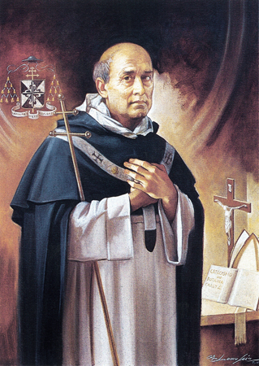

# São Bartolomeu dos Mártires

> "Arder e iluminar: esta deve ser a divisa do bispo."

- **Nascimento:** 3 de maio de 1514, Lisboa, Portugal
- **Morte:** 16 de julho de 1590, Viana do Castelo, Portugal
- **Festa Litúrgica:** 16 de julho
- **Beatificação:** 4 de novembro de 2001, pelo Papa João Paulo II
- **Canonização:** 10 de novembro de 2019, pelo Papa Francisco (Equipolente)

<TextToSpeech />

## Biografia

Bartolomeu Fernandes nasceu em Lisboa, na freguesia dos Mártires, local do qual adotaria o nome. Ingressou na Ordem dos Pregadores (Dominicanos) em 1528, no Convento de São Domingos de Lisboa, onde concluiu os seus estudos e se tornou um eminente teólogo. Foi mestre de teologia e prior em vários conventos dominicanos em Portugal.

Apesar de sua relutância inicial e desejo de continuar uma vida recolhida, ele foi nomeado Arcebispo de Braga em 1559, a pedido da Rainha D. Catarina. Como arcebispo, D. Bartolomeu destacou-se pela sua intensa dedicação ao rebanho, especialmente aos mais pobres, e pelo seu rigor moral. Ele implementou reformas profundas em sua diocese, focando na educação do clero e na evangelização do povo, antecedendo e aplicando as reformas do Concílio de Trento.

Ele participou ativamente do Concílio de Trento (1561-1563), onde sua voz foi uma das mais influentes. D. Bartolomeu defendeu fortemente a obrigatoriedade da residência dos bispos em suas dioceses e a necessidade de uma reforma pastoral profunda e verdadeira, focada na humildade e na caridade. Após retornar a Braga, fundou o seminário conciliar, o primeiro em Portugal e um dos primeiros no mundo, dedicando-se incansavelmente à sua diocese até renunciar ao cargo em 1582, retirando-se para o Convento de Santa Cruz em Viana do Castelo, que ele próprio havia fundado, onde viveu como um simples frade até à sua morte em 1590.

## Milagres

Em 10 de novembro de 2019, o Papa Francisco aprovou a canonização equipolente do Beato Bartolomeu dos Mártires. Isso significa que ele foi reconhecido como santo sem a necessidade de um milagre comprovado tradicional, mas sim com base no reconhecimento de sua santidade inquestionável, veneração contínua desde a sua morte e impacto duradouro na Igreja, expandindo seu culto para a Igreja Universal.

Durante sua vida, no entanto, muitos o consideravam um "santo vivo" devido à sua caridade extraordinária. Em tempos de peste e fome, ele esvaziou os celeiros e os fundos da arquidiocese para alimentar os necessitados, recusando-se a abandonar sua ovelhas. Ele frequentemente visitava hospitais e prisões, confortando e curando espiritualmente as pessoas, o que muitos viam como milagres de conversão e consolo profundo. A verdadeira cura que ele trouxe foi a renovação pastoral de uma diocese que necessitava desesperadamente de um pastor zeloso.

## Curiosidades

1.  **Voz em Trento:** No Concílio de Trento, ele proferiu uma frase que se tornou famosa: "Os Ilustríssimos Cardeais precisam de uma ilustríssima reforma". Isso demonstrava sua coragem e firmeza em exigir que a renovação da Igreja começasse por seus líderes.
2.  **O "Arcebispo Santo":** Ele era reverenciado pelo povo não por milagres espetaculares, mas por sua vida austera, sua pregação fervorosa e, acima de tudo, seu amor tangível e incondicional pelos pobres e marginalizados.
3.  **Renúncia Incomum:** Apesar de seu imenso poder e influência como Arcebispo Primaz das Espanhas (Braga), ele solicitou repetidamente a renúncia ao Papa, desejando retornar à vida simples do claustro dominicano. Seu pedido só foi concedido após anos de insistência.
4.  **Amigo de São Carlos Borromeu:** D. Bartolomeu construiu uma forte amizade e correspondência com São Carlos Borromeu, Arcebispo de Milão, colaborando estreitamente com ele nas reformas do Concílio de Trento.

## Cidades por onde passou

*   **Lisboa, Portugal:** Sua cidade natal e onde ingressou na Ordem Dominicana.
*   **Braga, Portugal:** Sé da sua arquidiocese, onde implementou reformas revolucionárias e exerceu seu episcopado.
*   **Trento, Itália:** Onde participou ativamente das sessões finais do Concílio de Trento.
*   **Viana do Castelo, Portugal:** Onde fundou o Convento de Santa Cruz, retirou-se após renunciar ao episcopado e viveu seus últimos dias, estando lá o seu túmulo.

## Impacto Hoje

São Bartolomeu dos Mártires é lembrado hoje como o modelo ideal de um pastor e bispo pós-tridentino: humilde, erudito, dedicado à reforma do clero e, sobretudo, um pai incansável para os pobres. Suas obras, especialmente o "Stimulus Pastorum", que detalha os deveres de um bispo, foram distribuídas aos padres conciliares no Concílio Vaticano I e no Vaticano II, demonstrando a relevância duradoura de sua visão sobre o ministério pastoral.

Sua canonização recente, em 2019, reacendeu o interesse por sua figura, não apenas em Portugal, mas em toda a Igreja, apresentando-o como um exemplo de que a verdadeira autoridade na Igreja provém do serviço, da austeridade e do amor ao rebanho, rejeitando a vaidade e o carreirismo eclesiástico. Ele continua sendo uma inspiração poderosa para clérigos e leigos comprometidos com a renovação e autenticidade da fé cristã.

<MiracleMap :items='[
  { lat: 38.7223, lng: -9.1393, type: "nascimento", title: "Lisboa", description: "Local de nascimento e entrada na Ordem Dominicana." },
  { lat: 41.5503, lng: -8.4200, type: "vida", title: "Braga", description: "Sé da Arquidiocese onde foi Arcebispo." },
  { lat: 46.0667, lng: 11.1167, type: "vida", title: "Trento", description: "Participação no Concílio de Trento." },
  { lat: 41.6932, lng: -8.8329, type: "morte", title: "Viana do Castelo", description: "Local de seu falecimento e onde repousam seus restos mortais." }
]' />