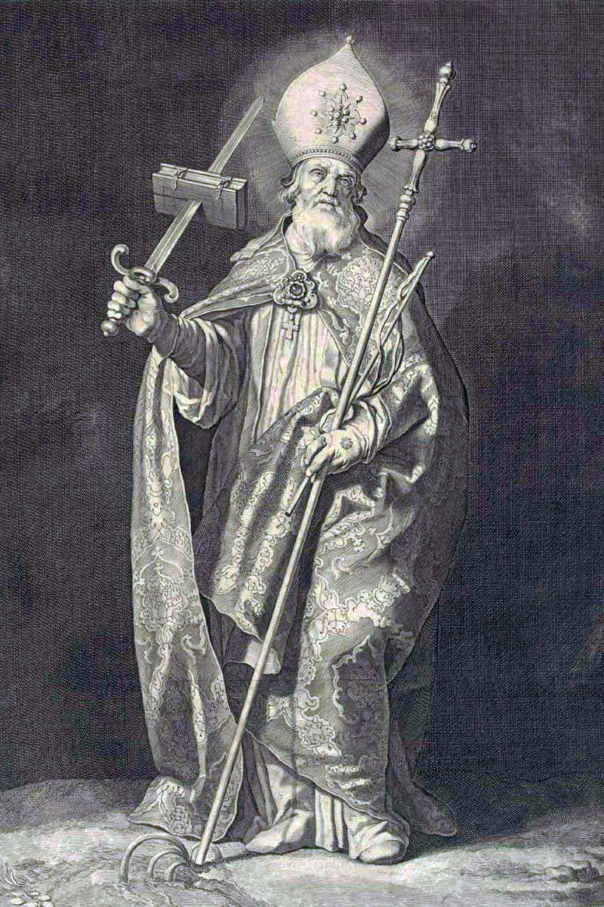

# São Bonifácio

> "Aquele que tiver a mente fortalecida pela paciência não se deixará perturbar pelas aflições, mas se tornará mais forte."

- **Nascimento:** c. 675 (Crediton, Wessex, Inglaterra)
- **Morte:** 5 de junho de 754 (Dokkum, Frísia)
- **Canonização:** Pré-congregação
- **Festa Litúrgica:** 5 de junho

<TextToSpeech />

---

## Biografia

São Bonifácio, conhecido como o "Apóstolo dos Alemães", nasceu Wynfrith (ou Winfrid) na Inglaterra por volta do ano 675. Ingressou no mosteiro de Exeter ainda jovem e, mais tarde, transferiu-se para a abadia de Nursling, onde se dedicou ao estudo e à oração. Foi ordenado sacerdote aos 30 anos e destacou-se como professor e estudioso das Sagradas Escrituras.

Apesar de uma carreira promissora na Inglaterra, Bonifácio sentiu um forte chamado missionário para evangelizar as terras pagãs da Europa continental. Em 716, iniciou sua primeira missão na Frísia (atual Holanda), que não teve sucesso. Em 719, dirigiu-se a Roma e recebeu do Papa Gregório II a missão oficial de evangelizar os povos germânicos, adotando então o nome de Bonifácio.

Ao longo de várias décadas, Bonifácio viajou incansavelmente pela Germânia (Alemanha moderna). Ele derrubou ídolos pagãos, batizou milhares de pessoas e estabeleceu a estrutura da Igreja na região, fundando inúmeras dioceses e o famoso mosteiro de Fulda, que se tornaria um grande centro de aprendizado e espiritualidade. Ele atuou não só como evangelizador, mas também como um organizador da Igreja em conjunto com o papado e com a corte franca, ajudando a estabelecer a aliança entre Roma e o reino dos francos.

Aos 79 anos, decidiu retornar à Frísia para continuar sua missão original. No entanto, em 5 de junho de 754, enquanto preparava um grupo de convertidos para a confirmação em Dokkum, foi atacado e martirizado por pagãos, defendendo-se apenas com um livro dos Evangelhos.

## Milagres

- **O Carvalho de Thor (Carvalho de Donar):** O episódio mais célebre de Bonifácio ocorreu em Geismar (Hesse), onde ele desafiou as crenças pagãs ao derrubar um carvalho sagrado dedicado a Thor (ou Donar). Segundo os relatos, as divindades pagãs não reagiram, e o carvalho caiu sem ferir ninguém, partindo-se em quatro partes em formato de cruz. Este evento provocou a conversão em massa dos presentes. Com a madeira da árvore, Bonifácio construiu uma capela dedicada a São Pedro.
- **A Árvore de Natal:** Diz a lenda que, ao derrubar o Carvalho de Thor, um pequeno abeto surgiu milagrosamente no local (ou foi apontado por Bonifácio), e o santo usou sua forma triangular para explicar a Santíssima Trindade, criando o que se tornaria o costume moderno da árvore de Natal.

## Curiosidades

- **Cartas de Bonifácio:** Sobreviveu um grande número de cartas de Bonifácio, oferecendo uma visão valiosa sobre a vida da Igreja primitiva, as missões e a sociedade do século VIII. Suas cartas revelam as dificuldades, o desencorajamento, e sua fé inabalável.
- **O Livro Escudo:** No momento de seu martírio, relata-se que Bonifácio tentou proteger sua cabeça com um livro dos Evangelhos. Um antigo manuscrito dos Evangelhos danificado, possivelmente pelo golpe da espada, é preservado até hoje em Fulda, reverenciado como uma relíquia.
- **Rede de Apoio:** Bonifácio contou com a ajuda essencial de monges e monjas da Inglaterra (como Santa Lioba e Santo Estêvão), que vieram apoiá-lo nas missões na Alemanha e na educação.

## Cidades por onde passou
- **Crediton:** Local de seu nascimento na Inglaterra.
- **Nursling:** Onde ingressou no mosteiro e foi ordenado padre.
- **Geismar (Fritzlar):** Onde derrubou o Carvalho de Thor, um marco em sua evangelização.
- **Fulda:** Fundou a abadia, que se tornou um importante centro eclesiástico, e onde repousam seus restos mortais.
- **Dokkum:** Cidade na Frísia onde foi martirizado enquanto evangelizava.

<MiracleMap :items='[
  { lat: 50.7833, lng: -3.6500, type: "nascimento", title: "Crediton", description: "Local de nascimento (c. 675)." },
  { lat: 51.1306, lng: 9.2783, type: "vida", title: "Geismar", description: "Local onde derrubou o Carvalho de Thor e construiu a capela." },
  { lat: 50.5522, lng: 9.6756, type: "vida", title: "Fulda", description: "Fundou a Abadia de Fulda; local de seu sepultamento." },
  { lat: 53.3255, lng: 5.9984, type: "morte", title: "Dokkum", description: "Local do martírio de Bonifácio." }
]' />

## Impacto Hoje

São Bonifácio é reverenciado não apenas como padroeiro da Alemanha (e da Inglaterra em alguns contextos), mas como um herói civilizacional. Sua obra de fundar igrejas, dioceses e mosteiros ajudou a moldar a Europa cristã medieval. O mosteiro de Fulda, fundado por ele e seu discípulo Santo Estêvão, tornou-se o centro religioso mais proeminente da Alemanha durante séculos e um importante bastião da erudição ocidental. Além disso, a tradição popular da árvore de Natal também ecoa seu legado pastoral na transformação de costumes pagãos em símbolos cristãos.

## Galeria de Imagens e Restaurações

| Original | Restaurada em 4K |
| :---: | :---: |
|  |  |

### Outras Imagens

| Imagem | Descrição |
| --- | --- |
|  | Representação de São Bonifácio derrubando o carvalho pagão. |
