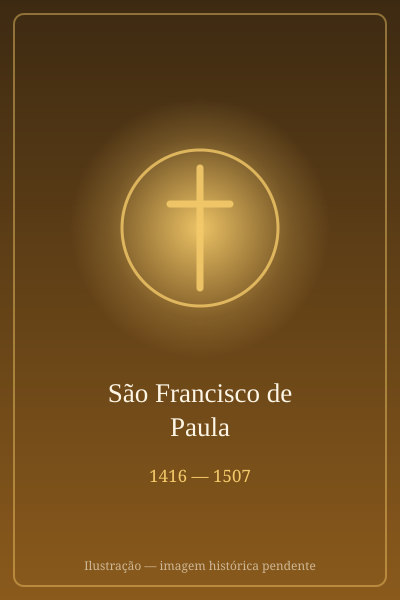

# São Francisco de Paula

> "A quem ama a Deus, tudo é possível."

- **Nascimento:** 27 de março de 1416, Paula, Calábria, Reino de Nápoles
- **Morte:** 2 de abril de 1507, Plessis-lez-Tours, França
- **Canonização:** 1 de maio de 1519, pelo Papa Leão X
- **Festa Litúrgica:** 2 de abril

<TextToSpeech />

---

## Biografia

Francisco nasceu na cidade de Paula, na região da Calábria (Itália), fruto das orações de seus pais a São Francisco de Assis, pois eles eram idosos e não tinham filhos. Na adolescência, já demonstrava uma grande inclinação para a vida religiosa. Após uma peregrinação com seus pais a Roma, Assis e Loreto, retirou-se para viver como eremita em uma caverna próxima de sua cidade natal, buscando uma vida de oração, penitência e extrema pobreza.

Com o tempo, outros jovens se juntaram a ele, atraídos por sua santidade e estilo de vida. Isso deu origem à Ordem dos Mínimos, caracterizada por um rigoroso voto de abstinência perpétua de carne e derivados de animais (laticínios, ovos), além da humildade, sendo o "mínimo" dos irmãos. A regra foi aprovada pela Igreja, e a Ordem se expandiu rapidamente.

A fama de santidade e os milagres de Francisco se espalharam por toda a Europa. O Rei da França, Luís XI, estando gravemente doente, pediu ao Papa que enviasse o santo para curá-mo. Francisco, embora relutante, obedeceu. O rei não foi curado fisicamente, mas Francisco o ajudou a aceitar a morte com paz e reconciliação espiritual. O rei, profundamente grato, pediu a Francisco que permanecesse na França como conselheiro de seus sucessores. Francisco passou o resto de seus dias em Plessis-lez-Tours, aconselhando os reis Carlos VIII e Luís XII.

## Vida Pessoal e Espiritualidade

São Francisco de Paula era um homem de extrema austeridade e penitência, mas também de profunda doçura e compaixão pelos pobres e doentes. Sua espiritualidade era centrada na caridade - o lema de sua ordem é "Charitas" (Caridade).

## Milagres

A vida de São Francisco de Paula é repleta de relatos de milagres. Um dos mais famosos ocorreu quando ele precisava atravessar o Estreito de Messina para ir à Sicília, mas não tinha dinheiro para pagar a passagem do barco. O barqueiro recusou-se a levá-lo. Francisco, então, estendeu seu manto sobre a água, amarrou uma das extremidades em seu cajado como se fosse uma vela, e navegou sobre o manto com seus companheiros até a outra margem.

## Curiosidades

1.  **Padroeiro:** É o padroeiro dos marinheiros e oficiais da marinha italiana, devido ao milagre de cruzar o estreito de Messina em seu manto.
2.  **Lema:** O emblema da Ordem dos Mínimos carrega a palavra "Charitas" envolvida em raios de luz, que Francisco teria visto no céu, trazida pelo Arcanjo Miguel.
3.  **Longevidade:** Apesar de sua vida de extrema penitência e jejum rigoroso (incluindo a abstinência perpétua de produtos de origem animal), ele viveu até os 91 anos de idade.

## Cidades por onde passou

<MiracleMap :items='[
  { lat: 39.3621, lng: 16.0396, type: "nascimento", title: "Paula, Calábria, Itália", description: "Local de nascimento e onde iniciou sua vida eremítica." },
  { lat: 38.1938, lng: 15.5540, type: "milagre", title: "Estreito de Messina, Itália", description: "Onde realizou o milagre de cruzar o estreito em seu próprio manto." },
  { lat: 47.3833, lng: 0.6833, type: "morte", title: "Plessis-lez-Tours, França", description: "Onde passou seus últimos anos como conselheiro real e faleceu." }
]' />

## Impacto Hoje

A Ordem dos Mínimos continua existindo hoje, dedicada à vida contemplativa, à pregação e ao cuidado pastoral. São Francisco de Paula continua a ser um modelo de humildade, penitência alegre e caridade infinita. Sua devoção é muito forte no sul da Itália, na França e em muitos outros países católicos.
