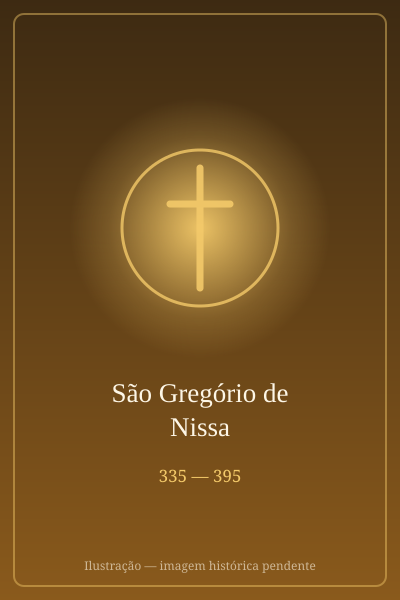

# São Gregório de Nissa

> "As ideias criam os ídolos; só o assombro conhece a Deus."

- **Nascimento:** 335, Cesareia, Capadócia (Turquia)
- **Morte:** 395, Nissa, Capadócia (Turquia)
- **Canonização:** Aclamação Popular, Padre da Igreja
- **Festa Litúrgica:** 10 de janeiro

<TextToSpeech />

## Biografia

São Gregório de Nissa foi um dos grandes Padres da Igreja do século IV, conhecido como um dos "Padres Capadócios" ao lado de seu irmão São Basílio Magno e de São Gregório Nazianzeno. Filho de uma família profundamente cristã (seus pais e avós são venerados como santos), Gregório inicialmente seguiu a carreira retórica e casou-se com Teosébia, mas, após a morte dela ou sob a influência de seu irmão e de sua irmã Macrina, a Jovem, voltou-se para a vida ascética.

Por volta de 371, São Basílio, que era bispo de Cesareia, o consagrou como bispo de Nissa (uma pequena cidade da Capadócia). Lá ele enfrentou uma forte resistência da facção ariana (que negava a divindade de Cristo). Ele chegou a ser exilado em 376 sob falsas acusações, mas retornou triunfalmente à sua diocese em 378, após a morte do imperador Valente.

Gregório foi uma das figuras centrais no Concílio de Constantinopla (381), onde defendeu o Credo Niceno, enfatizando especialmente a divindade do Espírito Santo. Ele deixou um grande legado de textos teológicos, místicos e espirituais, com uma profunda compreensão filosófica de Deus.

## Milagres

Os relatos de "milagres" na vida de São Gregório focam muito no aspecto intelectual e na iluminação providencial.

- Durante o exílio forçado pelos arianos, ele sofreu de fortes doenças e privações severas, mas milagrosamente sobreviveu para liderar sua diocese anos depois.
- Após a morte de seu irmão Basílio e de sua irmã Macrina, cujos milagres ele narrou, a sabedoria e pregação de Gregório ganharam fama milagrosa e conversões se multiplicaram pelo império.
- Ele curava espiritualmente os corações de hereges arianos, algo visto como uma verdadeira intervenção do Espírito Santo.

## Curiosidades

- São Gregório de Nissa tinha um irmão (Basílio Magno) e uma irmã (Macrina), que também foram figuras proeminentes no desenvolvimento do monaquismo e teologia.
- É considerado por alguns como o fundador da teologia mística sistemática devido a seus escritos sobre o progresso infinito da alma em Deus.
- Ele teve grande influência no neoplatonismo cristão.

## Cidades por onde passou

Gregório viajou para proteger e pregar a ortodoxia em diversas áreas do império:
- Cesareia, onde nasceu e foi criado.
- Nissa, sua sede episcopal.
- Constantinopla, onde se destacou como grande teólogo do Império.

## Impacto Hoje

Hoje, São Gregório de Nissa é intensamente estudado tanto pela teologia oriental (ortodoxa) quanto pela teologia ocidental (católica). Seus pensamentos sobre o mistério impenetrável da natureza de Deus e a deificação do ser humano o mantêm relevante no diálogo inter-religioso e no desenvolvimento da mística cristã.

<MiracleMap :items='[{ lat: 38.7188, lng: 35.4852, title: "Cesareia da Capadócia", description: "Local de nascimento e criação, influenciado por grandes santos.", type: "nascimento" }, { lat: 38.9056, lng: 34.0538, title: "Nissa", description: "Sede de seu episcopado, de onde foi exilado e depois retornou.", type: "morte" }]' />
