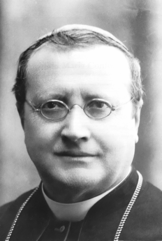

# São Guido Maria Conforti

> "Desejaria ser como a pequena haste que não tem luz própria, mas espalha no ambiente a luz viva que recebe do sol."

- **Nascimento:** 30 de março de 1865, Ravadese, Itália
- **Morte:** 5 de novembro de 1931, Parma, Itália
- **Beatificação:** 17 de março de 1996, pelo Papa João Paulo II
- **Canonização:** 23 de outubro de 2011, pelo Papa Bento XVI
- **Festa Litúrgica:** 5 de novembro

<TextToSpeech />

---

## Biografia

Guido Maria Conforti nasceu em Ravadese, Parma, a 30 de março de 1865. Foi o oitavo dos dez filhos de Rinaldo e Antónia, ricos agricultores. Apesar da forte oposição do pai (que o desejava gestor da vasta propriedade), foi o encontro com um crucifixo numa igreja em Parma, quando estudante infantil, que plantou a semente definitiva da vocação religiosa em Guido Maria. Costumava dizer: "Eu olhava para ele e ele olhava para mim e parecia que ele dizia muitas coisas para mim".

No Seminário, leu as histórias das missões e conversões no Oriente de São Francisco Xavier, desejando acompanhá-las, porém, teve a sua ordenação atrasada devido a graves episódios de epilepsia que o atormentavam desde adolescente. Uma vez ordenado e impedido, por razões de saúde e ordem superior de ir às missões na China, Conforti compreendeu que, se ele não poderia ir fisicamente, a sua vocação seria formar a legião que iria.

Aos 30 anos (1895), fundou o Instituto de Missões Estrangeiras (os Missionários Xaverianos, uma homenagem a São Francisco Xavier), aprovado oficialmente em Roma e focado apenas no apostolado e missões exteriores nos locais mais difíceis, os *Ad Gentes*. Concomitantemente a esta grande organização, o seu percurso pastoral levou-o a ser Arcebispo de Ravena, até abdicar por razões de saúde, e posteriormente, assumiu como o amado Arcebispo e Bispo de Parma, governando-a através dos tempos conturbados da Primeira Guerra Mundial, agindo pela pacificação, cuidando dos órfãos da guerra, mantendo o seminário e organizando Congressos Eucarísticos grandiosos.

## Milagres

Em 1996, foi beatificado pelo reconhecimento do milagre de Sabina Bussolati de Parma que sofria e definhava há muito tempo devido a cancro abdominal, que havia levado os médicos a não deixarem nenhuma esperança de cura clínica em 1965 e fora inesperadamente curada pelas preces da família junto do bispo Conforti.
Em 2011, obteve a confirmação da Santa Sé, de outro milagre – uma cura sem precedentes e rápida em 2003 de um menino de 12 anos em Burundi, curado repentina, completa e sem explicação médica de meningite bacteriana com hidrocefalia, resultando assim, na oficialização da Canonização, para Santo Guido Maria Conforti.

## Curiosidades

1.  **Doutrina e Ecumenismo:** Durante o tenso período entre a recém-criada república Italiana e a Santa Sé (conhecido como a questão romana), conseguiu por diplomacia um acordo informal para assegurar a protecção do Vaticano sobre as escolas em conflitos sociais crescentes em Itália, que culminariam em revoltas armadas nos anos 20, nas quais, literalmente arriscou o corpo nas barricadas em Parma.
2.  **O Crucifixo da Paz:**  Costumava sempre beijar e carregar o crucifixo de quando era estudante - mesmo durante uma violenta convulsão de grupos opostos em agosto de 1922 em Itália - conseguiu apaziguar a situação pondo-se perante o tiroteio em defesa das vítimas que sangravam.
3.  **China:** Embora frágil de saúde, em 1928 iniciou a realização do seu grande desejo e embarcou para visitar as Missões e Bispos dos Xaverianos pela Ásia, na China, espantando os irmãos de fé ao viajar por lugares infestados por malária a pé e por rios.

## Cidades por onde passou

O mapa abaixo reúne os lugares ligados ao fundador dos Missionários Xaverianos, Beato (São) Guido Maria Conforti:

<MiracleMap :items='[
  { lat: 44.8015, lng: 10.3279, type: "nascimento", title: "Ravadese, Itália", description: "Local de nascimento nas propriedades rurais." },
  { lat: 44.8012, lng: 10.3283, type: "vida", title: "Parma, Itália", description: "Onde viu a vocação e fundou os Missionários Xaverianos." },
  { lat: 44.8013, lng: 10.3284, type: "morte", title: "Parma, Itália", description: "Onde foi Bispo a maior parte da vida até a morte." },
  { lat: 34.3416, lng: 108.9398, type: "vida", title: "Missões Xaverianas (China)", description: "Viajou em 1928 para a Ásia para visitar o epicentro da Missão, inspirada pelo seu percurso e de São Francisco Xavier." },
  { lat: -3.3731, lng: 29.9189, type: "milagre", title: "Burundi", description: "País africano onde ocorreu o milagre final com um menino local para a sua canonização em 2011." }
]' />

## Impacto Hoje

Foi proclamado padroeiro das crianças em várias dioceses, especialmente porque sempre exigiu que a sua ordem providenciasse instrução. Ao estabelecer na sua vida fundações e missionários pelas mais duras estradas — até hoje presentes nas frentes da evangelização asiática e africana —, Santo Guido Maria Conforti é lembrado com enorme inspiração pelos actuais Missionários Xaverianos, que continuam e expandiram as suas acções ecumênicas. As suas igrejas não visam o poder, mas unicamente, como ele dizia "fazer do mundo uma só família, porque só Cristo nos fará todos, de facto e de coração, irmãos", deixando o testemunho que nunca a dor corporal e os grandes reveses da vida podem destruir a esperança, as vocações e os laços do homem em caridade.
