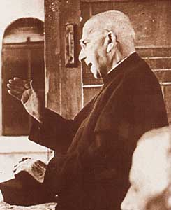

# São João Calábria

> "Deus Pai nos ama de um amor infinito."

- **Nascimento:** 8 de outubro de 1873, Verona, Itália
- **Morte:** 4 de dezembro de 1954, Verona, Itália
- **Canonização:** 18 de abril de 1999, pelo Papa João Paulo II
- **Festa Litúrgica:** 8 de outubro

<TextToSpeech />

---

## Biografia

João Calábria nasceu em Verona, na Itália, em 1873, sétimo filho de um sapateiro humilde e de uma mãe de fé profunda. A pobreza de sua família não o impediu de buscar o sacerdócio, embora ele tivesse que interromper os estudos para trabalhar após a morte de seu pai. Foi acolhido e ajudado pelo reitor do seminário, Padre Pietro Scapini.

Durante o serviço militar, no qual se destacou por sua dedicação e serviço voluntário como enfermeiro, João se aprofundou no cuidado com os necessitados e enfermos, experiência que influenciaria fortemente seu apostolado. Ordenado sacerdote em 1901, ele dedicou a vida aos "filhos e filhas espirituais", em particular jovens abandonados, órfãos, encarcerados e marginalizados.

Foi com base na confiança na Providência Divina e buscando dar uma resposta à pobreza da sua época que fundou a Congregação dos Pobres Servos da Divina Providência (para homens, em 1907) e, posteriormente, as Pobres Servas da Divina Providência (para mulheres, em 1910). Ambas as congregações se dedicam a acolher e educar jovens, administrar hospitais e prestar auxílio e assistência espiritual à população mais carente.

## Milagres

A canonização de São João Calábria ocorreu após a comprovação de vários milagres, geralmente ligados a curas inexplicáveis. Dentre as várias intercessões milagrosas, foi aceita para sua canonização a cura de uma doente crônica em estado grave sem possibilidade de cura médica. Em todo o mundo, paróquias e fiéis devotos relatam diversas bênçãos e curas após rezarem a Novena a São João Calábria.

## Curiosidades

1.  **Amizade inter-religiosa e teológica:** Mantinha correspondência profunda e de mútuo respeito com diversos intelectuais e religiosos do seu tempo. Ficou conhecida sua forte amizade e correspondência com o autor britânico C.S. Lewis.
2.  **Devoção à Providência Divina:** Proibia terminantemente que sua obra fizesse publicidade ou pedisse esmolas: confiava estritamente que se o trabalho fosse feito por amor e para Deus, as doações necessárias chegariam por "pura providência", algo que repetidamente acontecia, fortalecendo sua fama de santidade.
3.  **Proximidade com outros Santos:** O Papa João Paulo II, que o canonizou, tinha uma enorme devoção pessoal a São João Calábria e o considerava uma inspiração durante seus tempos difíceis na Polônia.

## Galeria de Imagens e Restaurações

| Original | Restaurada em 4K |
| :---: | :---: |
|  |  |

## Cidades por onde passou

Embora sua obra se tenha espalhado pelo mundo todo (incluindo uma forte presença no Brasil, como em Porto Alegre e São Paulo), a sua vida esteve quase sempre centrada na Itália, em torno de Verona.

<MiracleMap :items='[
  { lat: 45.4384, lng: 10.9916, type: "nascimento", title: "Verona, Itália", description: "Local de nascimento e falecimento. Onde fundou as congregações." },
  { lat: 45.4385, lng: 10.9915, type: "morte", title: "Verona, Itália", description: "Local de falecimento." },
  { lat: 45.4419, lng: 11.0000, type: "vida", title: "Casa San Zeno, Verona", description: "O centro de sua obra onde ajudava as crianças de rua." },
  { lat: 41.9029, lng: 12.4534, type: "milagre", title: "Vaticano", description: "Reconhecido pela Igreja Católica, canonizado em 1999." }
]' />

## Impacto Hoje

O legado de São João Calábria está vivo nas escolas, orfanatos, hospitais e obras assistenciais administradas pelos Pobres Servos e Pobres Servas da Divina Providência ao redor do mundo. Em tempos onde o utilitarismo e o acúmulo financeiro costumam ditar as regras, a obra de Calábria – baseada na confiança integral e cega no amor infinito de Deus e sem pedir recursos financeiros em troca – permanece como uma luz de esperança e uma lição viva de caridade cristã, em especial na atenção aos encarcerados e jovens abandonados, uma prioridade viva nas diversas paróquias calabrianas em todo o Brasil e no mundo.
