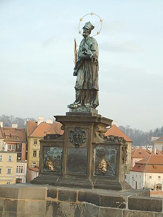

# São João Nepomuceno

> "Mártir do Segredo da Confissão"

- **Nascimento:** c. 1345, Pomuk (Boêmia, atual República Tcheca)
- **Morte:** 20 de março de 1393, Praga (Boêmia)
- **Canonização:** 19 de março de 1729, pelo Papa Bento XIII
- **Festa Litúrgica:** 20 de maio

<TextToSpeech />

---

## Biografia

João de Pomuk (ou Nepomuceno) nasceu em uma pequena vila da Boêmia. Ele estudou teologia e jurisprudência na Universidade de Praga e depois na Universidade de Pádua, onde obteve o doutorado em direito canônico. Tornou-se um sacerdote exemplar, conhecido por sua eloqüência como pregador e por sua sabedoria administrativa como vigário-geral da Arquidiocese de Praga.

A sua notoriedade provém principalmente de sua fidelidade inabalável ao sigilo sacramental da confissão. Segundo a tradição, a rainha Joana da Baviera, esposa do rei Venceslau IV, escolheu-o como seu confessor. O rei, movido por ciúmes infundados, exigiu que João lhe revelasse os pecados confessados pela rainha. Diante de sua firme recusa em quebrar o sigilo sacramental, João foi submetido a severas torturas.

Em 1393, por ordem do rei Venceslau IV, ele foi jogado vivo no rio Moldava a partir da Ponte Carlos, em Praga, afogando-se nas suas águas geladas, recebendo assim a coroa do martírio.

## Martírio

O martírio de São João Nepomuceno o tornou o primeiro mártir do selo da confissão. A história relata que, após ser lançado no rio, uma luz extraordinária iluminou a água e cinco estrelas pairaram sobre o local onde seu corpo jazia (representando a palavra *TACUI*, "eu calei", em latim). Isto permitiu que os fiéis o encontrassem e o sepultassem com as devidas honras. Quando, séculos mais tarde, o seu túmulo foi aberto, constatou-se que sua língua permanecia incorrupta.

## Curiosidades

1. **Santo das Pontes:** Devido à forma como foi martirizado (lançado de uma ponte), São João Nepomuceno tornou-se o padroeiro das pontes, dos rios, e de todos aqueles que têm ligação com as águas, protegendo também contra as inundações.
2. **Iconografia:** É frequentemente representado como um sacerdote segurando um crucifixo e uma palma de mártir, com cinco estrelas brilhando ao redor de sua cabeça.
3. **Expansão da Devoção:** Seu culto foi fortemente propagado pelos jesuítas e pela coroa dos Habsburgos, tornando-o imensamente popular na Europa Central, na Espanha e em muitas colônias da América Ibérica.

## Galeria de Imagens e Restaurações

| Original | Restaurada em 4K |
| :---: | :---: |
|  |  |

## Cidades por onde passou

Sua vida transcorreu quase que inteiramente na Boêmia e em algumas viagens de estudo na Itália.

<MiracleMap :items='[
  { lat: 49.4883, lng: 13.5816, type: "nascimento", title: "Pomuk (República Tcheca)", description: "Local de nascimento (c. 1345)." },
  { lat: 45.4064, lng: 11.8767, type: "vida", title: "Pádua (Itália)", description: "Local de seus estudos universitários onde obteve doutorado." },
  { lat: 50.0864, lng: 14.4114, type: "morte", title: "Praga (República Tcheca)", description: "Local de sua morte por afogamento no rio Moldava a partir da Ponte Carlos (20 de março de 1393)." }
]' />

## Impacto Hoje

São João Nepomuceno é um farol que ilumina o sacramento da confissão e a proteção da privacidade sagrada. A sua recusa em quebrar o silêncio, mesmo sob tortura e a custo da própria vida, é um testemunho eterno para todos os sacerdotes sobre o selo sacramental. Em muitas partes da Europa, há estátuas de João Nepomuceno guardando as pontes e protegendo a população das cheias. Sua memória sublinha a virtude da fortaleza, da discrição e do fiel compromisso com a verdade evangélica.
