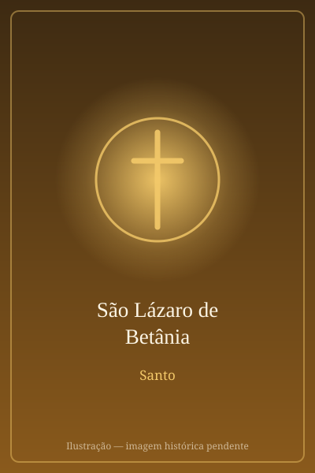

# São Lázaro de Betânia

> "Senhor, aquele que amas está doente." (Jo 11,3)

- **Nascimento:** Século I, Betânia, Judeia (atual Al-Eizariya, Palestina)
- **Morte:** Século I, Chipre (segundo a tradição oriental)
- **Canonização:** Pré-Congregação (Reconhecido desde os primeiros séculos)
- **Festa Litúrgica:** 29 de julho (junto com suas irmãs, Santa Marta e Santa Maria)

<TextToSpeech />

---

## Biografia

São Lázaro era irmão de Marta e Maria, e um dos amigos mais próximos de Jesus Cristo. Eles viviam em Betânia, uma pequena vila perto de Jerusalém. Os Evangelhos relatam que Jesus frequentemente se hospedava na casa de Lázaro e suas irmãs.

Quando Lázaro adoeceu gravemente, suas irmãs enviaram uma mensagem a Jesus, que estava do outro lado do rio Jordão. Jesus esperou dois dias antes de partir, e quando chegou a Betânia, Lázaro já estava morto e sepultado havia quatro dias. Movido por profunda compaixão e amor, Jesus chorou diante do túmulo de seu amigo.

Em seguida, Jesus ordenou que removessem a pedra do sepulcro e clamou com voz forte: "Lázaro, vem para fora!". Lázaro saiu do túmulo ainda envolto em faixas mortuárias. Este foi um dos maiores milagres de Jesus antes de Sua própria Paixão, demonstrando Seu poder sobre a morte.

Segundo tradições posteriores (como a tradição oriental), após a Ressurreição de Jesus, Lázaro e suas irmãs tiveram que fugir da Judeia devido a perseguições. Lázaro teria se tornado o primeiro bispo de Kition (atual Lárnaca, em Chipre), onde viveu por mais trinta anos antes de morrer de causas naturais.

## Vida Pessoal

Lázaro era conhecido por sua hospitalidade e pela profunda amizade que nutria por Jesus. A casa em Betânia era um local de descanso e comunhão. A ressurreição de Lázaro não apenas lhe devolveu a vida física, mas também o transformou em um testemunho vivo do poder de Cristo, atraindo muitos judeus à fé.

## Milagres

O maior "milagre" associado a São Lázaro é, de fato, o milagre de sua própria ressurreição, operado por Jesus Cristo. No entanto, ao longo dos séculos, muitos fiéis relatam graças e curas físicas alcançadas por sua intercessão, especialmente relacionadas a doenças graves e situações de morte iminente. Lázaro tornou-se um símbolo de esperança para aqueles que sofrem.

## Curiosidades

1. **Duas Tradições de Morte:** Há duas tradições sobre o destino de Lázaro. A tradição oriental diz que ele foi bispo no Chipre, enquanto a tradição ocidental (francesa) afirma que ele viajou para a Gália e se tornou o primeiro bispo de Marselha, sendo martirizado durante a perseguição de Domiciano.
2. **Igreja de São Lázaro:** Em Lárnaca, Chipre, existe a Igreja de São Lázaro, construída no final do século IX sobre o suposto segundo túmulo de Lázaro.
3. **Data da Festa:** Em 2021, o Papa Francisco aprovou a mudança no Calendário Romano Geral para celebrar Lázaro, Marta e Maria juntos no dia 29 de julho, enfatizando o testemunho da família inteira.

## Impacto Hoje

A história de São Lázaro continua a ser uma das mais comoventes dos Evangelhos, ensinando sobre a amizade verdadeira e o poder de Deus sobre a morte. Ele é invocado por pessoas que sofrem de doenças incuráveis e por aqueles que buscam renovação espiritual. O nome Lázaro também se tornou sinônimo de ressurreição e retorno à vida.

## Cidades por onde passou

<MiracleMap :items='[
  { lat: 31.7708, lng: 35.2608, type: "nascimento", title: "Betânia", description: "Onde nasceu e viveu. Local do milagre da sua ressurreição por Jesus." },
  { lat: 31.7683, lng: 35.2137, type: "vida", title: "Jerusalém", description: "Proximidades de onde ele acompanhou os ensinamentos de Cristo." },
  { lat: 34.9167, lng: 33.6292, type: "morte", title: "Lárnaca, Chipre", description: "Onde a tradição oriental diz que ele foi bispo, morreu novamente e foi sepultado." }
]' />

## Galeria de Imagens e Restaurações

| Representação Artística | Local Histórico |
| :---: | :---: |
|  |  |