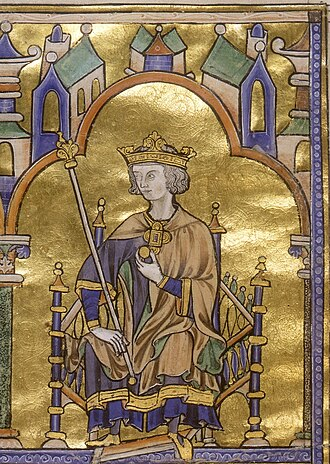

# São Luís IX

> "Rei justo e piedoso"

- **Nascimento:** 25 de abril de 1214, Poissy, França
- **Morte:** 25 de agosto de 1270, Túnis, Tunísia
- **Canonização:** 11 de agosto de 1297, pelo Papa Bonifácio VIII
- **Festa Litúrgica:** 25 de agosto

<TextToSpeech />

---

## Biografia

São Luís IX foi Rei da França, coroado aos 12 anos. Diferente de muitos governantes da época, Luís IX via seu poder não como um direito, mas como uma responsabilidade diante de Deus para servir seu povo. Reinou com profunda justiça e caridade cristã, estabelecendo a paz e fundando hospitais, orfanatos e tribunais que defendiam os mais pobres.

Ele conduziu duas cruzadas (a Sétima e a Oitava) com o desejo de proteger os lugares santos e os cristãos do Oriente, não por ambição política, mas por zelo religioso. Apesar de ter sido capturado na primeira e falecido de doença na segunda, seu exemplo de virtude permaneceu como modelo ideal de monarca católico para toda a Idade Média.

## Vida Pessoal e Reinado

Foi casado com Margarida de Provença, com quem teve 11 filhos, educando-os com grande rigor na fé cristã. Suas cartas e testamento para seu filho, Filipe, revelam um homem de profunda piedade, instando-o a preferir sofrer qualquer tormento a cometer um pecado mortal.

## Milagres

Sua vida inteira foi marcada por milagres de justiça e compaixão. Após sua morte durante a Oitava Cruzada em Túnis, numerosos milagres de cura foram relatados em seu túmulo em Saint-Denis, França, o que levou a sua rápida canonização pelo Papa Bonifácio VIII em 1297.

## Curiosidades

1. **Relíquias:** Adquiriu a Coroa de Espinhos de Cristo e construiu a belíssima Sainte-Chapelle em Paris especificamente para abrigá-la.
2. **Serviço Direto:** Ele frequentemente convidava pessoas pobres para jantar em sua mesa e lavava pessoalmente os pés de leprosos.
3. **Ordem Terceira:** Era membro da Ordem Terceira de São Francisco, vivendo uma vida de penitência e desapego, mesmo vestindo roupas reais.

## Galeria de Imagens e Restaurações

| Original | Restaurada em 4K |
| :---: | :---: |
|  |  |

## Cidades por onde passou

<MiracleMap :items='[
  { lat: 48.9286, lng: 2.0433, type: "nascimento", title: "Poissy, França", description: "Local de nascimento e de seu batismo." },
  { lat: 48.8556, lng: 2.3456, type: "vida", title: "Paris, França", description: "Capital do seu reinado e local da Sainte-Chapelle." },
  { lat: 36.8065, lng: 10.1815, type: "morte", title: "Túnis, Tunísia", description: "Local de falecimento durante a Oitava Cruzada." }
]' />

## Impacto Hoje

São Luís é um dos santos mais reverenciados na França e em muitos lugares do mundo. É padroeiro da cidade de São Luís do Maranhão, no Brasil. Também é padroeiro dos monarcas católicos e da Ordem Terceira Franciscana, sendo um modelo perpétuo de que o serviço público e a política podem ser formas elevadas de caridade e santidade quando exercidas com justiça e temor a Deus.
